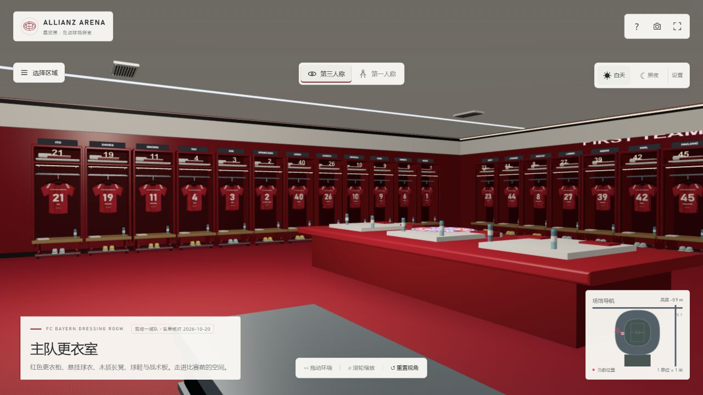

# 安联球场 · ARENA EXPLORER

使用 Three.js 0.186.1 制作的拜仁慕尼黑主场互动复原。所有几何体在浏览器内生成，Three.js 与控制器已经随项目附带；本地启动后不需要联网下载模型、贴图或脚本。

[在线探索](https://allianz-arena-explorer.pages.dev/) · [GitHub 源码](https://github.com/qiangua337/allianz-arena-explorer) · [Cloudflare 部署说明](docs/DEPLOYMENT.md) · [MIT 许可证](LICENSE)



版本 1.5：重做更衣柜、木凳、球衣织物、地面与室内灯光，加入倒角、收纳格、毛巾、接触阴影和灯具细部；入口接待台与导览设施、球员通道扶手与收口同步更新。发布厅座椅、商店货架、展柜和包厢餐桌座椅同步细化；界面改为小型可收起的控制区。

步行导航先判断所在房间，再沿内部过道绕开备战台、展柜、衣架和发布厅座椅；进出房间和返程使用不同提示。第一人称从南侧正门进入接待大厅，通过室内连续楼梯、公共环廊和连廊，步行到商店、展厅、包厢和三层看台。草坪、西侧球员通道、主客队更衣室及发布厅也保持步行连通。第一人称中的区域菜单与小地图只设置路线，不传送位置。

默认使用自适应流畅画质；标牌、球衣共享图集，重复构件合批，固定实时灯光预算，导航线复用缓冲区。增加感应自动门、奖杯介绍、可切换阵型的战术板、可切换球员并旋转的球衣陈列和坐下看球互动。

## 本地启动

Windows 已安装 Node.js 时，双击 `启动球场.cmd`。或在本文件所在目录运行：

```sh
npm start
```

随后打开 <http://localhost:4173>。保持启动窗口开启；关闭窗口会停止本地服务。不要直接双击 `dist/index.html`：浏览器通常会限制 file:// 页面的 ES 模块。

无需安装 npm 依赖，无需编译。建议使用 Node.js 24 或更新版本，与自动检查及部署环境一致。可用 `PORT` 环境变量指定其他端口。

## 操作

| 功能 | 操作 |
| --- | --- |
| 第三人称环绕 | 左键拖动；滚轮缩放；右键平移 |
| 第一人称 | 从南侧正门外出发；WASD / 方向键移动，按住画面拖动转头 |
| 转头 | 拖动鼠标 / 触摸画面，或 Q / E；可选「锁定鼠标」 |
| 加速 / 暂停 | Shift / Esc；移动键或点击画面可继续 |
| 昼夜切换 | 环境面板或 N |
| 视角切换 | 顶部切换按钮或 P |
| 重置 / 说明 | Home / H |
| 区域导航 | 左上「选择区域」按需展开；选区后自动关闭，点击画面 / Esc 也可收起；支持自动巡游 |
| 步行导航 | 底部选择全部开放区域，跟随路线；箭头和距离指向下一站 |
| 建筑剖看 | 关闭「显示建筑屋顶」 |
| 截图 | 右上相机图标保存纯三维画面 PNG |
| 场景互动 | 靠近设施按 F 或点击屏幕互动按钮；自动门靠近即打开 |
| 画质 | 默认流畅自适应；精细模式可显示建筑投影 |

区域面板默认关闭。切换到第一人称会直接来到南侧正门外，朝向开放入口；底部「回到正门」可随时返回。第一人称时，大标题和环境详细设置自动收起，保留移动控制、视角切换、昼夜按钮及小地图。鼠标锁定失败不会阻止行走和拖动转头；选择区域会规划步行路线，不移动当前位置。

## 包含的空间和细节

1. 球场全景：独立鼓起的 2,784 个菱形气枕、卷曲屋顶开口、外墙字牌、入口柱列、外部楼梯。
2. 南广场：起伏步道、绿色岛状景观、地下车库采光口、停车层、售票与安检设施、路灯、旗杆、座椅。
3. 三层看台：米制比例，参考 24° / 30° / 34° 坡度，约八万个座椅模型、灰色过道、分区编号、红白字样和栏杆；界面统计实际生成数量。
4. 草坪：105 × 68 米边界、草坪修剪条纹、场地线、球门与网格、角旗、足球、替补席、场边广告与摄像机。
5. 球员通道：红色几何墙面、深色顶面、白色长灯带、上行台阶与扶手、两侧队徽。
6. 主队更衣室：红色衣柜、木凳、衣架、球衣、球鞋与鞋钉、水瓶、毛巾、中央准备台、战术屏、电子时钟、装备箱、理疗床。
7. 客队更衣室与淋浴附属空间：浅色衣柜、备战桌、相邻淋浴区的花洒、地漏与瓷砖。
8. 新闻发布厅：阶梯红色座椅、后墙大队徽、赞助背景、发布台、麦克风、饮水、媒体摄像机。
9. 贵宾包厢：落地玻璃、窗框、餐桌、座椅、吧台、饮品。
10. 荣誉陈列空间：六个欧洲冠军年份、三维奖杯、底座、玻璃展柜、历史年份墙。
11. 环形公共大厅：环形通道、柱列、餐饮 / 商店柜台、灯具、WC、出口和分区导视。
12. 球迷商店：衣架、球衣、红白围巾、折叠商品、货架与服务台。
13. 入口环廊：沿 66 跨框架布置柱梁、七处开放入口组、连续内墙、混凝土拼缝和模板孔、服务窗口与货架、WC 门、信息台、休息长椅、回收箱、消防柜、票务机、场馆示意图、灯带与顶部管线。
14. 入场楼梯：八组混凝土楼梯，各 84 级踏步、对比色踏步边线、扶手、支撑柱、斜底板、平台、对应的楼板和外壳开口。可连续步行进入公共大厅。
15. 球场参观通道：接待区旁的中文开放入口、照明灯带、墙面展板、16 级场边踏步、配套的看台开口和双向通路。

场外还包含道路与高速公路、行车、巴士、轨道与 U6 站、维护建筑、树木、弗略特曼宁山的风机及小教堂的近似体块。

## 还原边界

这是公开参考资料驱动的程序化复原，并非经测量确认的施工 / BIM 模型。草坪与主要外廓以官方公布尺寸为依据，外壳气枕数量按公开统计建模。座椅数量是场景的几何数量，与官方国内赛事容量 75,024 人及实际售票清单不同。

更衣室视觉主要参考 2022 年官方照片；官方另有 2026 年 5 月更衣室整修公告，模型尚未完成整修后现状的逐处核对；球衣姓名与号码按 2026-10-20 拜仁官网一线队名单核对，更衣室和商店共用同一份数据；名册见 [docs/ROSTER.md](docs/ROSTER.md)。主客队房间的精确尺寸、连接动线、包厢陈设、商店、博物馆布展、入口和公共大厅设施的位置、楼梯尺寸及场外建筑都存在近似。第一人称按当前楼层选择可达地面；入口、环廊主要墙体和设施、楼梯侧栏有身体碰撞，未覆盖全部建筑构件。八组入口楼梯连接入口层与公共大厅，室内公共楼梯、连廊及公共大厅北侧缓坡连接其他楼层；区域导航在第一人称中只规划路线。日夜光照为实时艺术化表现。

未复制视频、音乐或完整官方照片作为页面内容；图像资料用于视觉研究，FC Bayern 队徽使用俱乐部官网的 SVG 资源并保持原始比例，具体出处与权利说明见第三方声明；其余场景贴图主要由代码绘制。非官方球迷项目，与 FC Bayern、Allianz 或场馆运营方无隶属关系。

研究依据与建模判断见 [docs/REFERENCES.md](docs/REFERENCES.md)，浏览器验证记录见 [docs/VERIFICATION.md](docs/VERIFICATION.md)。应用内也有「建模说明与参考资料」。

## 文件

| 文件 | 用途 |
| --- | --- |
| `dist/index.html` / `style.css` | 交互界面与响应式样式 |
| `dist/app.js` | 视角、漫游、昼夜、巡游、小地图与导航 |
| `dist/stadium.js` | 球场外壳、屋顶、看台与草坪 |
| `dist/interiors.js` | 内部空间、家具与柜台 |
| `dist/world.js` | 南广场及周边环境 |
| `dist/roster.js` | 现役姓名与号码、来源及核对日期 |
| `dist/navigation.js` | 正门出生点、分层地面与主要墙体碰撞 |
| `dist/circulation.js` | 入口环廊、服务设施、楼梯、标牌图集及大厅细节 |
| `dist/access-layout.js` | 楼梯尺寸、踏步高度、楼板开口和旋转碰撞的共享布局 |
| `dist/tour-route.js` | 参观通道布局、开放区域和分层步行路线图 |
| `dist/walk-guide.js` | 下一站提示、方向、距离和复用缓冲区的路线 |
| `dist/building-layout.js` / `walk-building.js` | 连续楼梯、平台、连廊及共享楼面布局 |
| `dist/interactions.js` | 自动门、展品、球衣、战术板与坐下互动 |
| `dist/finishes.js` | 倒角、木凳、毛巾、灯具、接待台及静态接触阴影 |
| `dist/wayfinding.js` / `furniture-layout.js` | 相对方向、进出提示、路径推进与家具净空 |
| `dist/performance.js` | 固定实时灯光预算 |
| `dist/assets/fc-bayern.svg` | 官方队徽，权利说明见 THIRD_PARTY_NOTICES.md |
| `dist/kit.js` | 程序化贴图、几何工具与绘制批次优化 |
| `dist/vendor/` | Three.js 0.186.1 与 MIT 许可 |
| `server.mjs` | 零依赖静态预览服务器 |

## 检查

```sh
npm run check
```

完整检查需要 Node.js 24，部署构建通过 `.node-version` 固定主版本。测试会沿全部目的地路线采样楼面高度，并使用实际场景构建器生成的墙体、扶手和设施碰撞数据检查通路。

静态部署只需将 `dist/` 内容放到支持 HTTPS 的静态服务器。

## Cloudflare 部署

```sh
npm run check
npm run deploy
```

生产托管使用 Cloudflare Pages，项目配置见 `wrangler.jsonc`。本地探索无需 npm 依赖；
`main` 分支推送后自动检查和部署；手动部署需要已登录的 Cloudflare 账号及 Node.js 22 或更新版本。
完整操作及自行部署方法见 [docs/DEPLOYMENT.md](docs/DEPLOYMENT.md)。

## 开源许可

原创代码使用 [MIT](LICENSE) 许可证。Three.js 的 MIT 许可及场馆、俱乐部标识说明见
[THIRD_PARTY_NOTICES.md](THIRD_PARTY_NOTICES.md)。欢迎通过 Issue 或 Pull Request 补充公开资料、修正模型和改进漫游体验。
