# 安联球场 · ARENA EXPLORER

使用 Three.js 0.186.1 制作的拜仁慕尼黑主场互动复原。建筑几何体主要在浏览器内生成，人物网格、贴图、声音、Three.js 与控制器已经随项目附带；本地启动后无需向外部网站下载资源。

[在线探索](https://allianz-arena-explorer.pages.dev/) · [GitHub 源码](https://github.com/qiangua337/allianz-arena-explorer) · [Cloudflare 部署说明](docs/DEPLOYMENT.md) · [MIT 许可证](LICENSE)

版本 **7.0：完整比赛流程与双方排阵**。

- 赛前分别选择两队的 11 人首发与替补，支持 4-2-3-1、4-3-3、4-4-2、3-5-2；联机双方各自保存本队阵容，房主确定对手、赛制与时长。
- 可选常规赛、平局加时后点球、平局直接点球、独立点球大战。常规时间可选 3 / 6 / 10 分钟；两半场换边并交换开球权，中场双方确认后继续。
- 真正的替补换人通过「阵容」登记并在死球执行：常规时间 5 人、3 次窗口，同一次死球多人换人只占一次，中场不占窗口，加时额外 1 人与 1 次窗口。Q /「换控」仅切换控制球员。
- 接触犯规可判任意球或禁区内点球；鲁莽抢断、危险冲撞与累积犯规会出牌，两黄变红，罚下球员离场且不能替换。点球大战双方轮流主罚和守门，支持提前结束、突然死亡，结果独立于比赛比分。
- 重新整理实战、联机、入场体验三个页面，优化手机阵容图、替补姓名、固定确认区和攻防动作键。点球使用专门镜头，竖屏能看到目标球门；排阵及阅读弹窗期间暂停重复绘制背景 3D 画面。

[7.0 玩法、规则与验证](docs/COMPETITION-7.md)。此版本使用联机协议 v2，双方需要刷新网页并重建房间。越位、补时、VAR 与完整手球判罚仍未实现；人物仍是通用模型。

版本 **6.1：改善联机操作响应与手机帧率节奏**。

- 本机移动与带球即时响应，按输入序号对齐服务器确认并平滑校准；服务器继续决定球权、抢断、得分和比赛时间。传射与抢断先播放本机动作提示，结果等待服务器确认。
- 修复手机 30 帧限速丢失剩余时间造成的额外掉帧；远处球员降低骨骼更新频率，位置仍保持平滑，手机均衡画质减少多重采样开销。
- 顶部同时显示实际网络毫秒数与渲染帧数；操作说明内可切换流畅画质。新建房间提供亚太位置提示，缩减同步数据和重复复制。网络往返延迟仍取决于实际线路，不能保证 300 ms 自动降成低延迟。

版本 **6.0：和朋友在不同设备联机对战**。

- 在「比赛日选项 → 和朋友联机」创建房间，复制邀请链接，或让朋友输入 8 位房间码。房主控制拜仁，朋友控制选定的多特、皇马、巴萨或曼城；每队 11 人，其余球员由 AI 配合。
- 两端准备并加载完成后统一开球。比赛由 Cloudflare 服务器计算，比分、时间、足球、球员、传射与抢断状态同步；保留手机摇杆、动作键和各自的换人辅助、镜头设置。
- 一方暂停或断线会冻结比赛；掉线后自动尝试恢复原席位，保留 60 秒重连时间。每个房间最多两人、30 分钟到期，比赛结束后双方可同意再来一场。
- 参观与人机赛保留原有入口。联机房间为双人对战，暂不包括多人共同参观、同队合作或随机匹配。

[打开赛前设置](https://allianz-arena-explorer.pages.dev/?place=pitch&night=1&experience=football) · [联机玩法与技术说明](docs/MULTIPLAYER.md) · [部署前后端](docs/DEPLOYMENT.md)

版本 **5.1：修复展柜串内容，完善展品辨识与手机查阅**。

- 全场互动改为视线选中：按 F 或点击时重新确认当前目标。荣誉展柜的高亮、提示和介绍使用同一份记录，隔墙或身后的展品不会抢占选择；中央玻璃柜的空白部分也不会挡住后方展板。
- 每座个人展柜补齐姓名、奖项、年份与展品类型；球衣直接标注 KANE · 9、MÜLLER · 25 和配色示意。铭牌保持正常文字比例，修复过扁的字形。
- 参考 UEFA 官方奖杯照片重做里贝里奖杯的立体半身、上扬双臂与底座，修复金球表面的内部网格穿插。凯恩的获奖记录重新核对官方资料。
- 手机横屏目录与介绍压缩标题空间，保留可滚动内容和固定关闭按钮；实际检查 390 × 844 与 844 × 390 视口。

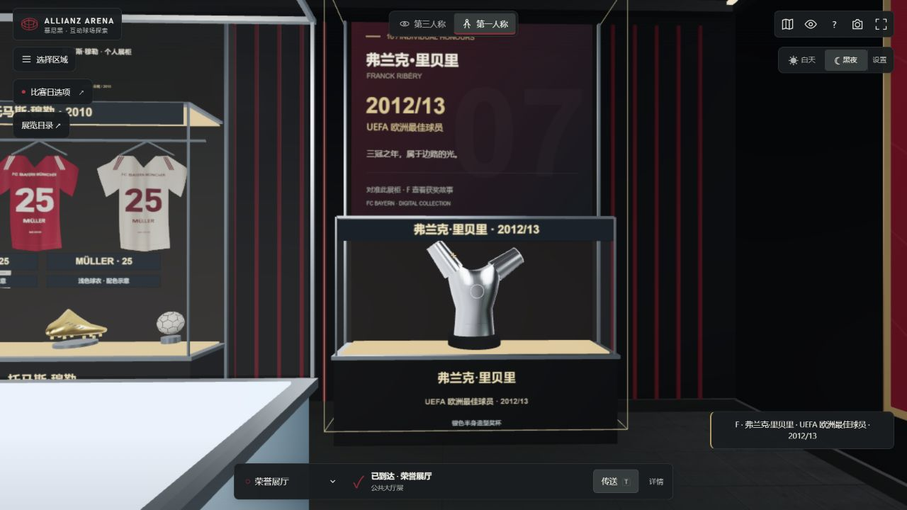

[进入荣誉展厅](https://allianz-arena-explorer.pages.dev/?place=museum&night=1) · [5.1 修复依据与验证](docs/EXHIBIT-FOCUS-5.1.md)

版本 **5.0：参考真实展陈与设施，重调射门和门将**。

- 荣誉展厅参考拜仁官方 2026 改造照片，调整双排透光展台、深色设备顶和红黑展板；新增十组个人荣誉展柜，包括金球、金靴、金手套、The Best 和 UEFA 最佳球员，附年份、故事与原始资料。
- 参照凯恩真实展柜增加球衣、比赛球、射手炮和纪念物示意；可走近按 F，也可用可搜索目录查看。实景参考可在目录中展开，压缩布展与估算尺寸明确标注。
- 主要设施修订包括高背侧翼替补座椅、180 席发布厅、转播摄像机与线缆、媒体灯架和分段升降康复台；家具、踏步、导航与碰撞同步检查。
- 门将有反应时间、有限触球范围和扑倒恢复，支持抱住、脱手与补射；Z / 手机按钮切换劲射、搓射和挑射，蓄力显示弧线与球门目标。回放和比赛数据同步适配。

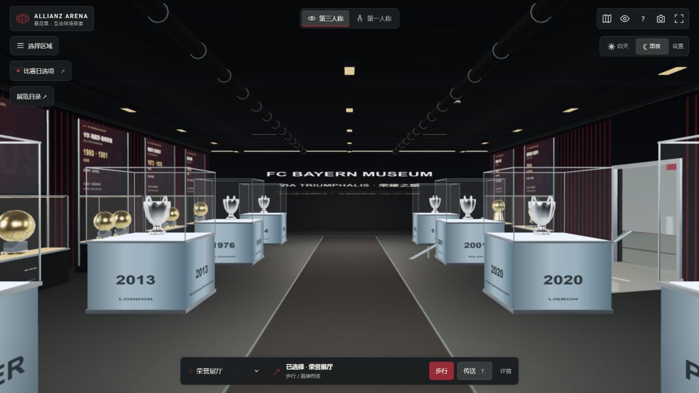

[进入荣誉展厅](https://allianz-arena-explorer.pages.dev/?place=museum&night=1) · [赛前设置](https://allianz-arena-explorer.pages.dev/?place=pitch&night=1&experience=football) · [实景资料、范围与对照验证](docs/REALISM-AND-ATTACK-5.md)

版本 **4.0：场馆、导览与比赛整体精修**。[直接打开赛前设置](https://allianz-arena-explorer.pages.dev/?place=pitch&night=1&experience=football)。

- 草坪增加门前磨损、细颗粒纹理和随观看方向变化的割草反光，夜场重新平衡填充光；场边补摄影设备、补水与医护器材、训练锥、排水及喷淋五金。
- 球门立柱和横梁支持连续碰撞反弹，进球位置触发短暂球网波动。可手动点击「回放」或 R 回看最近进球 / 片段，支持慢放、原速和重播，真实比赛在回放期间保持冻结。
- 地图按球员层、入口层、公共大厅、中层和上层显示实际房间及连接通道；点击本层地点选择导航，金线只显示当前层。更衣室、发布桌与商店补充小件，时钟显示慕尼黑当地时间。
- 手机摇杆增加小死区与渐进力度，丢失触点时清空输入；回放控件适配横竖屏。省电模式保留全场观众，关闭附近立体人群；均衡模式随预算调节近景数量。

制作范围、操作、性能与验证记录见 [4.0 更新说明](docs/REFINEMENT-4.md)。

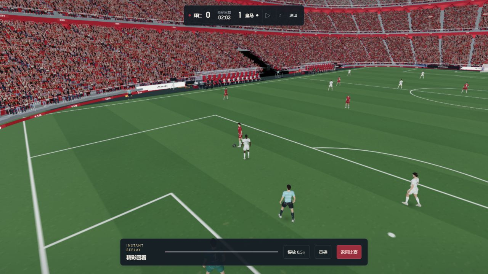

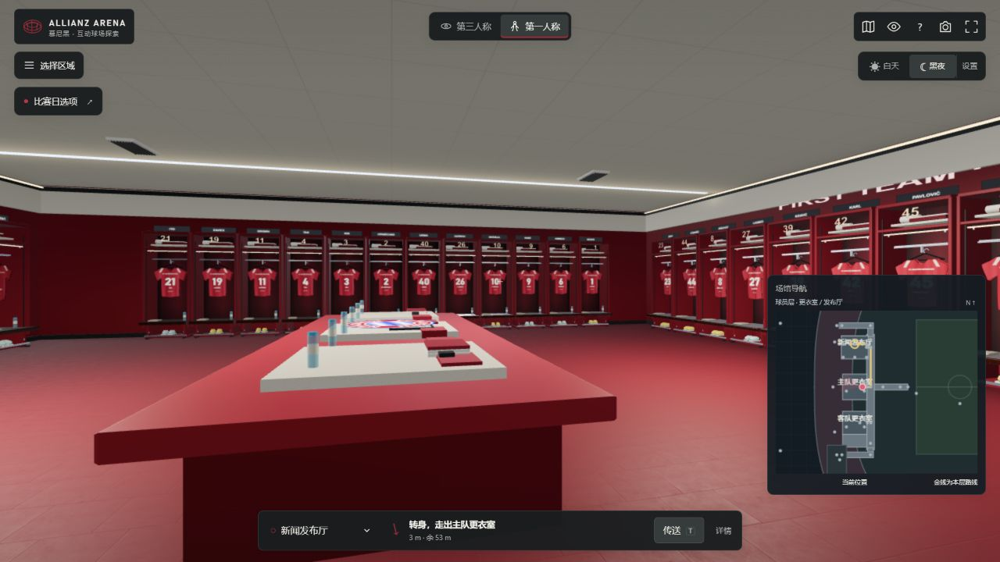

版本 3.1：重做比赛日观众与助威互动。

- 更新八组生成的球迷图像，改善肩宽、肤色、衣服和人物轮廓，避免红色人形与红座椅混成一片。
- 近处换用有手臂、腿部和围巾的坐姿立体观众，桌面最多 384 人、手机最多 128 人；远处保留分区实例平面，共享图集。手机保留全场占座密度，靠近时才更新细节。
- 新增右上「助威」按钮与 G 快捷键，声浪、人物动作和旗帜作出反应；射门、抢断、扑救及进球也有不同强度反馈。客队区按对手换色。贴图加载失败仍保留可见的人形，并支持重试。

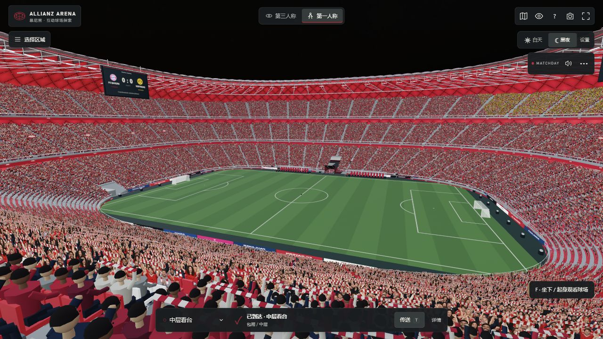

人物图集、生成提示词、性能预算与简化范围见 [CROWD-ASSETS.md](docs/CROWD-ASSETS.md)。普通参观默认空场，比赛日和人机比赛显示观众。以下 3.0 比赛操作继续保留：

- 赛前可选多特蒙德、皇家马德里、巴塞罗那、曼彻斯特城，以及轻松、标准、挑战三档难度。切换实际首发和替补、姓名号码、球衣配色、比分标题及场内 LED；新增球队采用字母标记与独立绘制的配色球衣。阵容为官方号码资料上的示范选配，不是当场首发。
- 默认侧面广角转播镜头，兼顾持球者和足球；竖屏镜头自动靠近，长传时略微拉开。C 或右上按钮在转播、跟随与第一人称之间切换，保留手动、半自动、辅助换人。全场雷达显示 22 名球员、受控球员和足球。
- 传球按方向输入选择接应和线路，并预览目标。J 短传、L 直塞，接球队员迎球，进攻球员前插；支持接球前短暂预输入一脚传球。按住 K/F 或手机射门按钮蓄力，松手出球，力度实际影响球速；持球加速、护球和抢断分别控制，抢断有短暂出脚窗口和冷却反馈。
- 门将根据来球轨迹横移，门前有实际拦截及扑救反馈，防守者补位封堵；轻松难度降低 AI 推进速度与反应。传射使用原创建模的击球声，重开和终场使用原创哨声，保留现场人群声景。终场显示双方射门、传球和抢断次数，暂停或终场可直接返回更换对手。
- 比赛界面收起参观工具栏；手机左右分别为摇杆、加速和六个动作键，重新安排横竖屏触控区。比赛时停用场外、室内绘制和对应更新，使用较轻的看台及远景人物网格；远处骨骼降频，暂停停止重复骨骼计算。均衡画质按比赛实际绘制帧率调整分辨率。

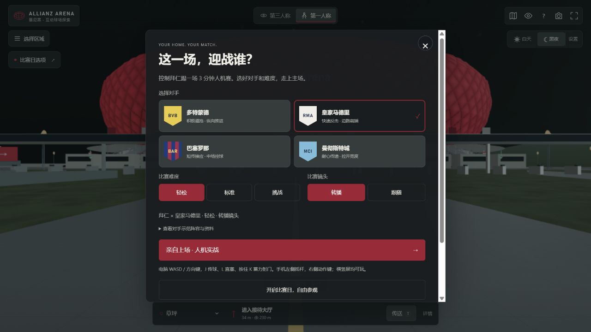

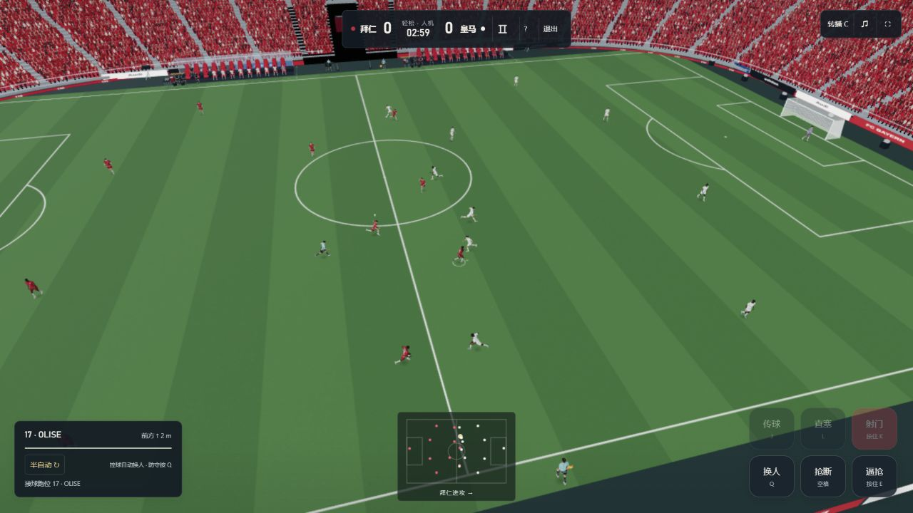

操作说明见 [GAMEPLAY.md](docs/GAMEPLAY.md)。它仍是独立的简化人机体验赛，没有联网对战、越位、完整犯规判罚或球星扫描；比赛日参观与跟队入场保留固定拜仁 × 多特示范。

版本 2.2：重做操作辅助与对抗手感。比赛中可切换「手动 / 半自动 / 辅助」，设置独立保存。手动保留所控球员，半自动在队友接球或夺回球权后接管持球者，辅助额外选择合适的防守球员；手动换人后短暂保持选择，避免连续跳人。白色三角显示下一位可切换球员。E / 手机长按「逼抢」会跟随足球方向贴近对手，松开即停止自动贴近，持球时同键改为减速护球；空格或「出脚」触发有冷却与动作反馈的抢断。

抢断改为检测真实球的位置、出脚方向和持球者遮挡，成功先将球拨松再回收，减少身体一碰就交换球权。接停增加短暂保护，冲刺时趟球稍大，转身采用角速度限制；起步、刹停和换人镜头缓和。开球时对手退到中圈以外。新接入 Quaternius CC0 的慢跑与冲刺循环，按位移速度混合走、跑、冲刺，并在传球、射门和出脚时叠加小幅足球动作；未使用《实况足球》的代码或游戏文件。它是独立的简化实现，动作与规则仍不等同于完整商业足球游戏。

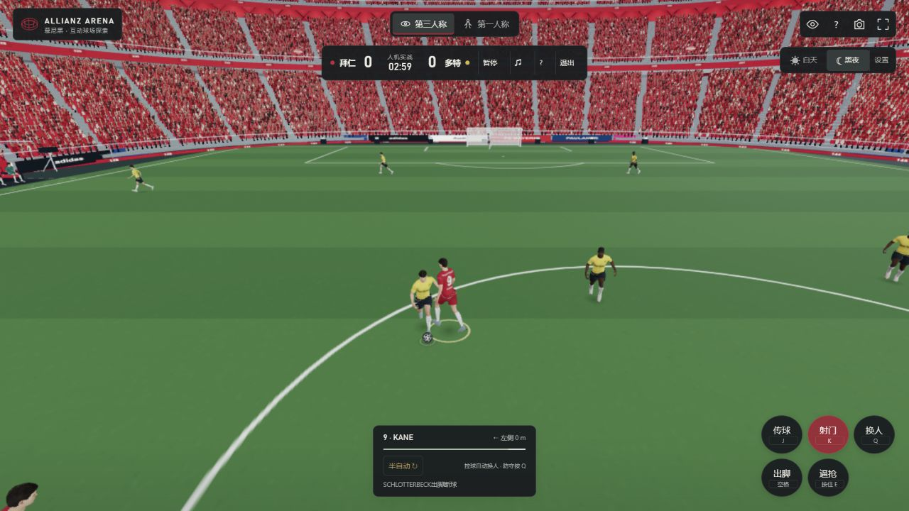

版本 2.1：加入可以亲自参与的 **3 分钟 11 对 11 人机体验赛**。在「比赛日选项」选择「亲自上场」，控制一名拜仁球员，对战多特蒙德 AI。支持带球、加速、选队友传球、射门、抢断、换人、门将接球扑救、进球计分，以及边线球、角球和球门球的简化重开。队友会接应与进攻，对手会逼抢、传递和射门；用户传球被队友接到后会切换到接球队员。第一人称隐藏受控人物，第三人称从身后跟随，其他球员的位置由模拟决定。

电脑用 WASD 移动、Shift 加速、J 传球、K/F 射门、空格抢断、E 长按逼抢或护球、Q 换人、拖动或左右方向键转向、V 切换视角、Esc 暂停。手机保留左侧摇杆、加速开关和右侧六个动作键，比分区提供暂停、声音、帮助和退出。游戏期间关闭参观导航与场馆碰撞，退出恢复进入前的位置、视角、昼夜与导航；加载完成前不计时，加载失败可以重试或退出。复用现有 52 名首发、裁判、替补和工作人员；人物视觉更新与游戏渲染在手机上限为每秒 30 次、桌面为 60 次（不代表设备实测帧率保证）。球员移动与足球物理采用固定时间步进，避免掉帧穿过球门或重复计分。

这是本地运行的人机体验赛，采用简化规则，没有联网玩家、真实赛事实况数据、越位与完整犯规判罚。入口为显式选择，普通参观和跟队入场继续分别保留。[直接打开比赛选项](https://allianz-arena-explorer.pages.dev/?place=pitch&night=1&experience=football)。

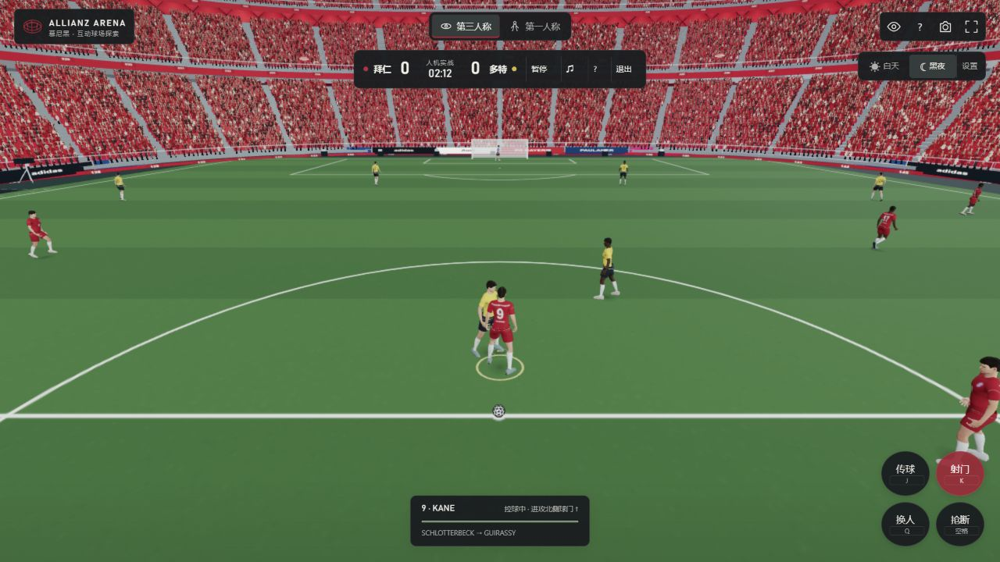

版本 2.0：升级整套表面和环境照明。六类 CC0 扫描材质加入混凝土、木纹、墙漆、橡胶、织物和草地的法线与粗糙度，木材使用真实颜色贴图；三套 1K HDR 分别提供日间、夜间与室内反射。夜空亮度单独校准，白天补光降低，避免原有直接光与环境光叠加过亮。素材全部同源托管，初次 PBR/HDR 传输约 10.29 MiB，后续可缓存；手机上传到 GPU 的表面纹理为 512，桌面为 1024。省电模式关闭额外法线和粗糙度采样。两个固定室内灯、局部草叶和近景座椅预算继续生效。

荣誉展厅重做八座展柜、金属包边、展台灯带和墙面历史板：六座欧洲冠军杯具有空心杯身、卷边、双耳与铭文，另两件分别为同心银环与绿色镶饰的德甲冠军盘、金色杯身与装饰带的德国杯。靠近按 F 可查看每件展品的故事、比分和资料链接。模型仍是代表性解释，并非奖杯扫描或博物馆真实布展。修复弧形外壳穿入展厅、商店和包厢的体积相交，裁切同时作用于深度通道。客队更衣室移除虚构的 GAST 连号，按可选比赛日同一份多特蒙德示范名单悬挂黄黑球衣；这不是某场真实比赛的名单或球衣精确复刻。原有连续步行和单独传送保持可用。

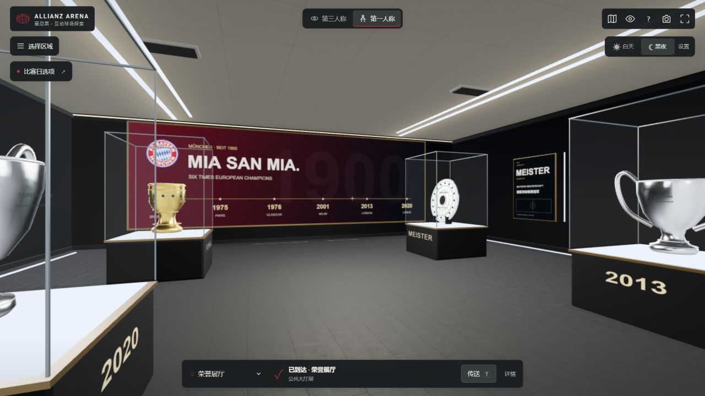

版本 1.13：细化走近时的物体形状和材料。发布厅改用 84 个代表性座席，重新协调座椅宽度、座垫、圆润靠背、细金属腿与中央过道，软包增加织纹和包边；陈设数量仍为演示布局。背景屏按 5:1 实际比例制作贴图，减少字样与标识的横向拉伸。更衣室球衣增加起伏布面、独立织纹坐标、缝线与衣架挂钩，背板增加柔和遮蔽，柜体与木座面补充反光层次，毛巾使用软包形状，商店的可旋转展示球衣也共用同一套衣物轮廓和印字。顶面增加细接缝，通道墙板有实际厚度和倒角，重复斜线合并绘制。看台前方 6 米内按需替换弧形塑料座面、靠背和金属支架，保留远处简化模型；细节区只增加两个实例绘制对象，手机最多 128 个、默认桌面最多 192 个，精细模式最多 384 个。省电模式关闭这片近景替换。所有座位位置、楼层和既有通行路线共用原有坐标，另检查新发布厅座席的身体通行余量。更衣柜使用同一份位置生成可见陈设与碰撞，避免穿入柜体。

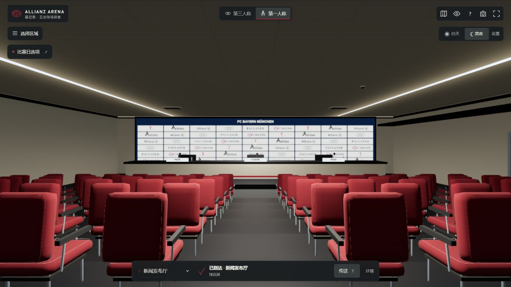

版本 1.12：继续更新画面与照明。室内灯按真实房间范围分配，避免隔墙灯具抢占预算；两个固定渲染灯改为向下的柔边照明，灯具切换和环境明暗平滑过渡。室内增加不依赖额外渲染通道的墙角遮蔽与灯槽漫反射，红色地面补上按米铺设的细微凹凸。夜间将场外环境与内场补光分开，远处或从暗通道看向球场时，草坪和看台保留照明。外壳发光随气枕中心到边缘变化，避免整片平涂红；入口铺地、草地和道路补充颗粒纹理，灯下光池与外壳在地面的红色漫射仅增加两个轻量绘制对象。发布厅传送落点移到后排中央过道，进来即可看见媒体座席和发布台。照明和阴影为视觉近似，并非工程照度或光线追踪模拟。

版本 1.11：更新整体参观体验。新增三条可选步行导览（主场初访、俱乐部故事、球员的一天），到站后手动进入下一站，保留自由选区和直接传送。导航显示下一路点与剩余总路程、预计步行时间。步行起步缓冲并在松手时立即停止，暂停和打开面板时清除输入。新增省电画质并记住用户选择；均衡画质自适应分辨率，手机可关闭近景草叶并降低像素开销。墙面和地面采用按米铺设的细节纹理、凹凸和接缝，调整室内光照层次，连接走廊增加品牌展示和通风格栅。气枕外壳减小鼓起幅度，红色灯光延续至外侧屋顶。大体量固定几何按粗分区拆分，保持顶板独立开关与原有碰撞模型。1280×720、正门外相同位置的对照中，三角形由 494,408 减至 396,362；绘制提交由 93 变为 106。这个对照不代表所有设备的帧率。

版本 1.10：重做室内连通与导航。球员区走廊的南北两端均通过有顶连接通道回到接待环廊；公共环廊边界绕开房间，内侧设施随墙体重排。各层楼梯、中上层看台连廊补齐顶板、侧墙与转角平台，上层入口从看台背后进入并朝向球场。房间、楼梯、环廊外壳不再按当前位置整组隐藏；公共大厅表面扣除商店和展厅范围，避免几何重叠。导航检查整条路线并缓存固定路段的检查结果，自动绕开后续设施；沿坡度判断碰撞，修复楼梯上方墙体的误判；途经连廊时不会把起点匹配到座椅过道。仅在确实抵达目的地时显示到达。以上内部连接为模型的参观动线近似，并非施工图复原。

版本 1.9.1：修复球员区大片深蓝背景。走廊实际地面、天花、侧墙与端头按同一份布局生成，并与碰撞及步行支撑范围一致；补齐客队淋浴区的侧墙、地面和顶板。房间外壳与陈设分开裁剪，从走廊看向房门、从更衣室看向走廊时，墙体保持完整。保留球员通道望向草坪的视线，不再把远端球场提前隐藏。增加实际几何射线与边界行走回归检查。

版本 1.9：整体更新草皮、夜场照明、看台人群色彩与双队记分屏；草坪近处使用轻量草叶，远处使用带纤维凹凸的纹理。比赛日按需开启，默认自由参观并保持当前位置，另选 44 秒跟队入场。补齐拜仁与多特蒙德各 11 名首发、双方共 18 名替补、8 名教练与医护、4 名裁判；提供阵容面板和场边传送入口。球员采用 Quaternius CC0 行走、站立、坐姿和交谈动画，适配现有骨架，保持独立路线。人物合并为单张图集和单次身体绘制，远处使用较轻网格，手机使用 512 像素图集。步行同时检查可站立区域与上下落差，防止进入看台下方。比赛日靠近足球可以按 F 或点击「踢球」。人物为通用面部，阵容为展示用途；来源及许可见 [人物资源说明](docs/PLAYER-ASSETS.md)。

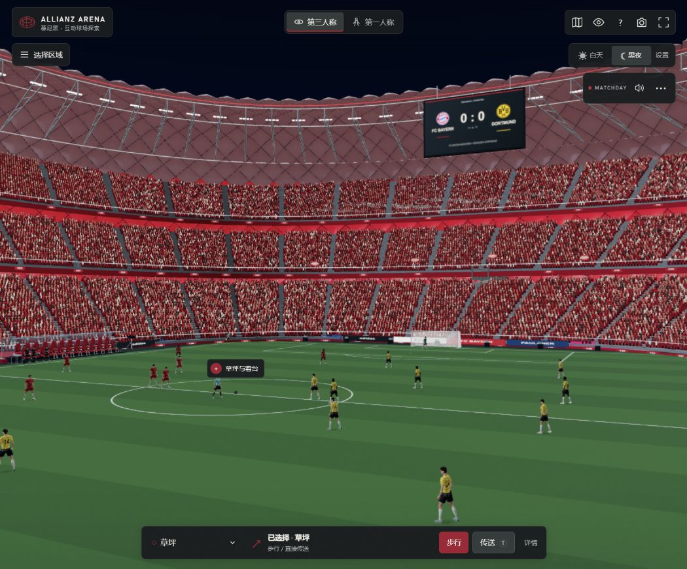

版本 1.7：修复室内楼梯踏步、平台和侧墙未提交到场景的问题；黄线仅绘制前方有地面支撑的一段。公共大厅 SERVICE 双门可以手动打开，门后有设备间或储物间，可实际步行进出。选区改为可搜索、分类的紧凑菜单，底部指引默认单行，地图按需打开，可一键隐藏界面。手机提供移动摇杆、拖动转头和加速按钮。

场外遮挡内场时跳过看台绘制，座椅按距离使用三档几何，重复建筑构件合批、固定静态变换；静止画面降低绘制频率。加载阶段预编译材质，减轻第一次进入房间时的卡顿。入口相同桌面视角的绘制提交从 1.6 的 233 次降至约 90 次；实际帧率取决于设备与视角。


版本 1.5：重做更衣柜、木凳、球衣织物、地面与室内灯光，加入倒角、收纳格、毛巾、接触阴影和灯具细部；入口接待台与导览设施、球员通道扶手与收口同步更新。发布厅座椅、商店货架、展柜和包厢餐桌座椅同步细化；界面改为小型可收起的控制区。

步行导航先判断所在房间，再沿内部过道绕开备战台、展柜、衣架和发布厅座椅；进出房间和返程使用不同提示。第一人称从南侧正门进入接待大厅，通过室内连续楼梯、公共环廊和连廊，步行到商店、展厅、包厢和三层看台。草坪、西侧球员通道、主客队更衣室及发布厅也保持步行连通。选择区域会同步底部目的地与路线；需要直接抵达时，另点传送按钮或按 T。

默认使用自适应流畅画质；标牌、球衣共享图集，重复构件合批，固定实时灯光预算，导航线复用缓冲区。增加感应自动门、奖杯介绍、可切换阵型的战术板、可切换球员并旋转的球衣陈列和坐下看球互动。

## 本地启动

Windows 已安装 Node.js 时，双击 `启动球场.cmd`。或在本文件所在目录运行：

```sh
npm start
```

随后打开 <http://localhost:4173>。保持启动窗口开启；关闭窗口会停止本地服务。不要直接双击 `dist/index.html`：浏览器通常会限制 file:// 页面的 ES 模块。

无需安装 npm 依赖，无需编译。建议使用 Node.js 24 或更新版本，与自动检查及部署环境一致。可用 `PORT` 环境变量指定其他端口。

## 操作

| 功能 | 操作 |
| --- | --- |
| 第三人称环绕 | 左键拖动；滚轮缩放；右键平移 |
| 比赛日 | 左侧「比赛日选项」；自由参观保持当前位置，跟队入场另行选择；声音在点击后启用 |
| 阵容与替补席 | 比赛日右上角「⋯」展开控制，选择「阵容」；可直接传送到场边 |
| 足球 | 比赛日靠近中圈足球，按 F 或展开比赛日控制后点击「踢球」 |
| 第一人称 | 从南侧正门外出发；WASD / 方向键移动，按住画面拖动转头 |
| 转头 | 拖动鼠标 / 触摸画面，或 Q / E；L 锁定 / 释放鼠标 |
| 手机移动 | 左下摇杆移动，拖动画面转头；「跑」切换速度 |
| 加速 / 暂停 | Shift / Esc；移动键或点击画面可继续 |
| 昼夜切换 | 环境面板或 N |
| 视角切换 | 顶部切换按钮或 P |
| 重置 / 说明 | Home / H |
| 区域导航 | 左上或底部地点打开搜索 / 分类菜单，选区后自动关闭；支持自动巡游 |
| 步行导航 | 咨询台、区域菜单或底部选择目的地，跟随黄线；第三人称可点「步行」 |
| 直接传送 | 「传送到目的地」按钮或 T；在对应楼层的开放通道落点继续探索 |
| 地图 / 沉浸 | M 或地图按钮开关地图；U 或眼睛按钮隐藏 / 恢复界面 |
| 建筑剖看 | 关闭「显示建筑屋顶」 |
| 截图 | 右上相机图标保存纯三维画面 PNG |
| 场景互动 | 靠近设施按 F 或点击屏幕互动按钮；自动门靠近即打开，SERVICE 双门手动开关 |
| 画质 | 默认流畅自适应；精细模式可显示建筑投影 |

区域面板和地图默认关闭。首次进入第一人称从南侧正门外出发；之后从第三人称切回会恢复上次步行位置并保留目的地。Home 或选择「南侧正门」后点传送可返回。第一人称时大标题隐藏，环境设置与路线详情按需展开。鼠标锁定失败不会阻止行走和拖动转头；选择区域会规划步行路线，传送另用按钮或 T。更换目的地后指引保持紧凑，传送按钮始终保留。

## 包含的空间和细节

1. 球场全景：独立鼓起的 2,784 个菱形气枕、卷曲屋顶开口、外墙字牌、入口柱列、外部楼梯。
2. 南广场：起伏步道、绿色岛状景观、地下车库采光口、停车层、售票与安检设施、路灯、旗杆、座椅。
3. 三层看台：米制比例，参考 24° / 30° / 34° 坡度，约八万个座椅模型、灰色过道、分区编号、红白字样和栏杆；界面统计实际生成数量。
4. 草坪：105 × 68 米边界、草坪修剪条纹、场地线、球门与网格、角旗、足球、替补席、场边广告与摄像机。
5. 球员通道：红色几何墙面、深色顶面、白色长灯带、上行台阶与扶手、两侧队徽。
6. 主队更衣室：红色衣柜、木凳、衣架、球衣、球鞋与鞋钉、水瓶、毛巾、中央准备台、战术屏、电子时钟、装备箱、理疗床。
7. 客队更衣室与淋浴附属空间：浅色衣柜、备战桌、相邻淋浴区的花洒、地漏与瓷砖。
8. 新闻发布厅：阶梯红色座椅、后墙大队徽、赞助背景、发布台、麦克风、饮水、媒体摄像机。
9. 贵宾包厢：落地玻璃、窗框、餐桌、座椅、吧台、饮品。
10. 荣誉陈列空间：六个欧洲冠军年份、三维奖杯、底座、玻璃展柜、历史年份墙。
11. 环形公共大厅：环形通道、柱列、餐饮 / 商店柜台、灯具、WC、出口和分区导视。
12. 球迷商店：衣架、球衣、红白围巾、折叠商品、货架与服务台。
13. 入口环廊：沿 66 跨框架布置柱梁、七处开放入口组、连续内墙、混凝土拼缝和模板孔、服务窗口与货架、WC 门、信息台、休息长椅、回收箱、消防柜、票务机、场馆示意图、灯带与顶部管线。
14. 入场楼梯：八组混凝土楼梯，各 84 级踏步、对比色踏步边线、扶手、支撑柱、斜底板、平台、对应的楼板和外壳开口。可连续步行进入公共大厅。
15. 球场参观通道：接待区旁的中文开放入口、照明灯带、墙面展板、16 级场边踏步、配套的看台开口和双向通路。

场外还包含道路与高速公路、行车、巴士、轨道与 U6 站、维护建筑、树木、弗略特曼宁山的风机及小教堂的近似体块。

## 还原边界

这是公开参考资料驱动的程序化复原，并非经测量确认的施工 / BIM 模型。草坪与主要外廓以官方公布尺寸为依据，外壳气枕数量按公开统计建模。座椅数量是场景的几何数量，与官方国内赛事容量 75,024 人及实际售票清单不同。

更衣室视觉主要参考 2022 年官方照片；官方另有 2026 年 5 月更衣室整修公告，模型尚未完成整修后现状的逐处核对；球衣姓名与号码按 2026-10-20 拜仁官网一线队名单核对，更衣室和商店共用同一份数据；名册见 [docs/ROSTER.md](docs/ROSTER.md)。主客队房间的精确尺寸、连接动线、包厢陈设、商店、博物馆布展、入口和公共大厅设施的位置、楼梯尺寸及场外建筑都存在近似。第一人称按当前楼层选择可达地面；入口、环廊主要墙体和设施、楼梯侧栏有身体碰撞，未覆盖全部建筑构件。八组入口楼梯连接入口层与公共大厅，室内公共楼梯、连廊及公共大厅北侧缓坡连接其他楼层；区域导航在第一人称中只规划路线。日夜光照为实时艺术化表现。

未复制视频、音乐或完整官方照片作为页面内容；图像资料用于视觉研究，FC Bayern 队徽使用俱乐部官网的 SVG 资源并保持原始比例，具体出处与权利说明见第三方声明；人物皮肤等使用 CC0 资产，建筑贴图主要由代码绘制。非官方球迷项目，与 FC Bayern、Allianz 或场馆运营方无隶属关系。

研究依据与建模判断见 [docs/REFERENCES.md](docs/REFERENCES.md)，浏览器验证记录见 [docs/VERIFICATION.md](docs/VERIFICATION.md)。应用内也有「建模说明与参考资料」。

## 文件

| 文件 | 用途 |
| --- | --- |
| `dist/index.html` / `style.css` | 交互界面与响应式样式 |
| `dist/app.js` | 视角、漫游、昼夜、巡游、小地图与导航 |
| `dist/stadium.js` | 球场外壳、屋顶、看台与草坪 |
| `dist/interiors.js` | 内部空间、家具与柜台 |
| `dist/world.js` | 南广场及周边环境 |
| `dist/roster.js` | 现役姓名与号码、来源及核对日期 |
| `dist/navigation.js` | 正门出生点、分层地面与主要墙体碰撞 |
| `dist/circulation.js` | 入口环廊、服务设施、楼梯、标牌图集及大厅细节 |
| `dist/access-layout.js` | 楼梯尺寸、踏步高度、楼板开口和旋转碰撞的共享布局 |
| `dist/tour-route.js` | 参观通道布局、开放区域和分层步行路线图 |
| `dist/walk-guide.js` | 下一站提示、方向、距离和复用缓冲区的路线 |
| `dist/walk-path.js` | 从当前位置接入路线、设施净空检查、局部绕行和分层地图路径 |
| `dist/walk-motion.js` / `arrivals.js` | 与帧率无关的分步地面更新、各目的地传送落点 |
| `dist/building-layout.js` / `walk-building.js` | 连续楼梯、平台、连廊及共享楼面布局 |
| `dist/interactions.js` | 自动门、展品、球衣、战术板与坐下互动 |
| `dist/finishes.js` | 倒角、木凳、毛巾、灯具、接待台及静态接触阴影 |
| `dist/wayfinding.js` / `furniture-layout.js` | 相对方向、进出提示、路径推进与家具净空 |
| `dist/performance.js` | 固定实时灯光预算 |
| `dist/scene-budget.js` | 静态合批、变换固定、内场可见性和空闲绘制预算 |
| `dist/destinations.js` | 地点分类、搜索与共享选区菜单 |
| `dist/ribbon-path.js` | 限长且贴合实际楼面的指引线 |
| `dist/service-layout.js` / `service-rooms.js` | 服务间布局、双门动画、室内设施及开门碰撞 |
| `dist/assets/fc-bayern.svg` | 官方队徽，权利说明见 THIRD_PARTY_NOTICES.md |
| `dist/kit.js` | 程序化贴图、几何工具与绘制批次优化 |
| `dist/vendor/` | Three.js 0.186.1 与 MIT 许可 |
| `server.mjs` | 零依赖静态预览服务器 |

## 检查

```sh
npm run check
```

完整检查需要 Node.js 24，部署构建通过 `.node-version` 固定主版本。测试会沿全部目的地路线采样楼面高度，并使用实际场景构建器生成的墙体、扶手和设施碰撞数据检查通路。

静态部署只需将 `dist/` 内容放到支持 HTTPS 的静态服务器。

## Cloudflare 部署

```sh
npm run check
npm run deploy
```

生产托管使用 Cloudflare Pages，项目配置见 `wrangler.jsonc`。本地探索无需 npm 依赖；
`main` 分支推送后自动检查和部署；手动部署需要已登录的 Cloudflare 账号及 Node.js 22 或更新版本。
完整操作及自行部署方法见 [docs/DEPLOYMENT.md](docs/DEPLOYMENT.md)。

## 开源许可

原创代码使用 [MIT](LICENSE) 许可证。Three.js 的 MIT 许可及场馆、俱乐部标识说明见
[THIRD_PARTY_NOTICES.md](THIRD_PARTY_NOTICES.md)。欢迎通过 Issue 或 Pull Request 补充公开资料、修正模型和改进漫游体验。
