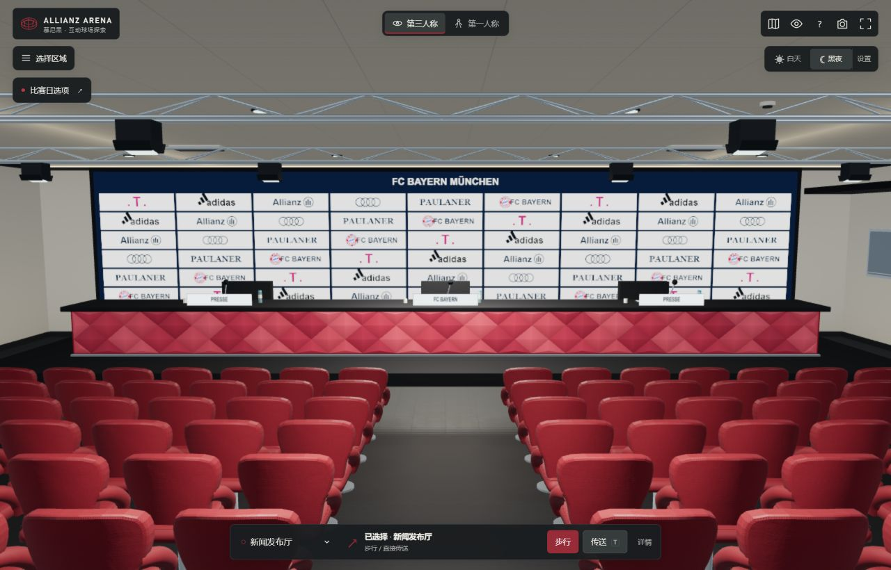
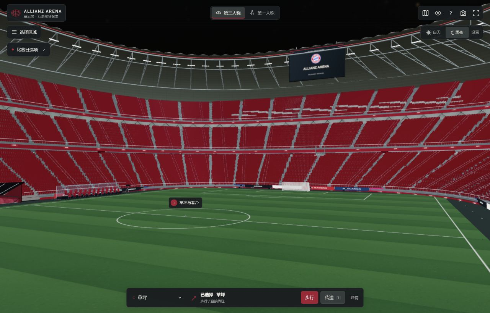

# 验证记录

## 当前版本 9.3.0，2026-11-10

- 完整 `npm run check` 共 479 项通过；最终文案更新后，字体覆盖、照片选择器、主屏路由的 8 项专项检查再次通过。没有修改比赛模拟、网络协议、预测器、Worker 或人物网格。
- 首页以中文作为主标题，主操作区分别提供实战设置和自由参观；好友卡通过独立 `online` 回调直接进入房间页。回归确认先恢复旧输入状态再打开联机页，延迟到达的原生 close 事件不会覆盖新页面。浏览器实际点击了主操作、联机直达及自由参观，后者进入 `?place=entrance&view=walk`，可直接接收步行输入。
- 两颗原生按钮手动切换凯恩与穆西亚拉现有照片，同步图片、尺寸、alt、姓名、号码、拍摄背景和 `aria-pressed`，焦点留在激活按钮；重复激活不重复设置图片。实际点击和空格键由凯恩切到穆西亚拉，返回首页保留当前选择。组件无自动轮播、定时器或指针追随，提供幂等清理函数，缺失 DOM 时安全返回。照片和三份字体文件均未改动，没有新增大图下载。
- 主照片在桌面优先 contain 保护完整人物主体，穆西亚拉使用独立焦点与侧边渐隐；竖屏为独立照片卡，文字与照片不再叠放。手机主操作 46 px 高、照片按钮 44 px 高；四入口与页脚可正常纵向滚动访问。
- 本地浏览器检查 1280×720、1024×768、844×390、667×375、390×844、320×568。平板两列入口；最终 1024×768 的主屏 `client=1024×768 / scroll=1024×768`，844×390 为 `client=844×390 / scroll=844×390`，四入口底边约 316.17 px。窄竖屏按内容纵向滚动，所有检查未出现横向溢出。尺寸模拟不能代替实体手机性能测量。

## 版本 9.2.0，2026-11-10

- 本轮为首页及训练、比赛、联机页面的视觉更新，不修改足球模拟、网络协议、预测器或 Worker。原 473 项完整回归通过，新增字体专项 2 项通过。
- 中文正文与标题分别使用 Noto Sans SC 的 500/800 静态子集，英文使用 Barlow Condensed SemiBold 衍生字体；三份 WOFF2 共 328,492 B。扫描最终 126 个非 vendor 的 JS/HTML（含来源页、实体和 Unicode 转义），两份中文各覆盖 1,088 字符，现有 951 个 CJK/全角标点无缺失，特殊图标保留系统回退。固定 Google Fonts 源版本、完整 OFL、SHA、构建方法和覆盖清单随项目附带，重复构建三份字体及清单均字节一致。
- 使用两张真实球星影像：Werner100359 摄影的 2025 凯恩拜仁热身服写真，以及 Bryan Berlin / WikiPortraits 摄影的 2026 穆西亚拉德国队照片。两份 WebP 共 161,840 B，保留 CC BY-SA 4.0、原文件页、作者及变更说明；来源页明确区分真实照片、通用游戏模型和拍摄背景。
- 实际浏览器检查 1280×720、390×844、320×568 和 844×390；首页在桌面及 390 竖屏完整显示四入口，320 小屏与横屏支持纵向滚动；未产生横向溢出。实际点击新增开球入口、训练卡及比赛/训练/联机切页。修正了比赛卡片在日景下白底配白字、队名难读以及页首装饰负边距导致横向滚动的问题。手机训练说明 12 px，对手说明 11 px，页签点击高度 44 px。
- 首页只新增一次性 transform/opacity 淡入与鼠标悬停反馈；小屏关闭入场动画，`prefers-reduced-motion` 关闭过渡与动画。使用本地照片和字体，不增加外部字体请求或持续播放视频。
- 公开 Pages `9366ec13` 检查显示 `9.2.0`，两张图均完整加载，资源失败数为 0，应用错误日志为空。390×844 四入口底边分别为 571.5/571.5/707.5/707.5 px，首屏无横向或纵向溢出；公开训练页说明为 12 px，弹窗无横向滚动。15 个新旧发布资源的校验值与本地一致，三份字体 MIME 均为 `font/woff2`。公开基础联机 15 项单次通过；本轮未重跑完整赛程/恢复审计，Worker 保持 9.1 发布版本。浏览器尺寸模拟不等于实体手机性能跑分。

## 版本 9.1.0，2026-11-10

### 实玩、人物与界面

- 最终 `npm run check` 共 473 项全部通过，包括实际蒙皮、脚底净空、左右侧移、停步反向、触球、真实第一脚接传、界面生命周期、联机渲染与 Worker 下半场时钟回归；没有降低原有预算或扩大超时时限。
- 实际浏览器在 390×844 完成一场拜仁×多特的 180 秒上下半场比赛，使用真实键盘移动、传球、逼抢、抢断和蓄力射门，中途暂停、继续，最终 1:6；本方 4 次起脚、3 次射正、8 次传球、14 次抢断。记录为 `player910-trace.json` 与 `player910-fulltime.png`。这是流程和动作操作验收，并非胜率或 AI 强度的统计试验。
- 公开站的三角传接实际完成 5 次成功、5 次尝试、最佳连续 5；连续按传球会显示“已预备 · OLISE 接球后传球”，传球后按射门会显示“已预备 · OLISE 接球后射门”。球在真实接触接应者之前保持无主，UI 不提前展示持球射门轨迹。自动对照中快按回吸从 24/24 降为 0/24，实际一脚再传由 0/16 变为 16/16，擦边高速低球的物理接触和近失球分别验证。
- 910 门将手套改为原创闭合有体积五指网格，裁去腕带覆盖的裸皮，保留 18 骨骼、单图集材质与单人物绘制。真实站姿、行走、跑步、射门和双向扑救的 64 组姿态，覆盖全部腕部皮肤顶点与 1,792 条接缝射线；目测掌面、背面、腕口及全身扑救通过。门将 27,016 三角形，外场 27,092；新 bin 为 1,432,728 B，旧 850/840/初代文件保持字节一致，重复构建结果一致。
- 慢速外场侧移按移动方向平滑转髋，上身与头部有限回看，真实支撑脚沿地面稳定；54 组左右及前后斜向、60/30/12 Hz 的实际鞋底扫描，最坏接地滑移中位约 0.0000026 m/s，原纯侧移约 2.63 m/s，起落边缘最大仍约 4.79 m/s，最低鞋底在地面上方约 5.1 mm。停步、左右反向、恢复前进、侧移传射与门将方向均有回归；不把中位数写成所有帧完全无滑动。
- 无球远离足球时，近景优先保留受控人物，边缘提示寻找远球。在同一 390×844、离球约 52 m 的固定投影样本中，人物高度约 16.79→42.96 px；仍迎球或持球、训练与定位球保留原取景。真实场馆几何射线继续检查遮挡。
- 同一真实 HUD 的 10 秒、30 Hz、300 次更新，DOM setter 调用由 9,825→85，最终比赛状态一致；外部修改标签后能恢复，真实传球、暂停、继续和退出反映到 UI。这里只表示冗余界面写入减少，不等同手机整帧加速比例。
- 两个实际浏览器端分别使用 390×844 与 844×390，完成建房、输入房间码、双方准备、各自移动传射和触屏摇杆操作；中场仅一端确认时停表等待朋友，双方确认后换边继续，自然完成 `period=2 / elapsed=180 / fulltime / 0:0`。公开站竖屏无横向溢出，主传球键 58×57 px、换控键 58×44 px，资源失败数 0，应用错误日志为空。尺寸模拟不代替实体手机 GPU 或用户线路跑分。

### 本地联机与手机网络展示

- 冻结全部场馆、比赛和 Worker 源码后，在本地真实 Pages/Worker 服务运行基础联机 15 项、完整赛制 13 项、实际客户端恢复 8 项，首轮全部通过。使用公开 HTTP/WebSocket 指令自然完成 180 秒上下半场、中场双方确认、换边、替补、实际交替罚球，以及下半场 OPEN 快照阻断和传输断线；没有写入游戏状态、扩大原有时限或跳过真实赛程。恢复终点双方均为 `period=2 / elapsed=180 / fulltime`，比分和序号一致，全程无权威时钟回退。记录为 `online-base-910-local.json`、`online-competition-910-local.json`、`online-recovery-910-local.json`。
- 与 Git `4b8744b` 的在线客户端、预测器运行相同实际模拟：300 ms RTT、±65 ms 有序延迟变化、30 Hz 变化输入和 30 fps 展示。在稳定匀速的 68 帧样本中，远端单帧位移标准差 0.14566→0.01672 m，最大位移 0.69147→0.21083 m，近乎停住的帧 11→0。缺失 10% 快照的有界投递间隙实验中，停顿 15→0；60 fps 同类实验中 33→0。这是确定性响应实验，不把快照缺失模拟称为 WebSocket 物理丢包，也不将该比例当作实体手机 FPS 提升。
- 远端按服务器时间连续播放，目标缓冲 100–220 ms，只延后远端位置与展示速度；本地受控者位置、速度、出脚反馈仍即时。四个正常/抖动/缺帧配置的隔离控球样本中，本地完整轨迹与旧版逐帧一致。比分、球权、计时、半场、判罚和预备传射提示仍来自最新权威包；控制切换、进球、暂停、中场与重连清理旧位姿。120 秒持续抖动及缓冲变化回归确认播放时间不倒退，恢复稳定投递后不累计落后，也不会在停流后无限外推。
- 固定位姿队列为 8 槽、7,232 B，包含远端 x/z/yaw/vx/vz；预测历史最多 90 条、0.6 秒。每个快照不再创建两组逐球员位姿数组及其中 44 个对象。逼抢和碰撞使用独立的 22 份最新权威人物记录，不能从已插值的展示位置反向影响本地预测；停步/反向的速度与位置同时间轴回归、本地速度不进入缓冲的断言通过。
- 动作、替补和设置可在同一服务器时刻额外广播状态；抖动估计改用相邻权威时间差，不把同刻动作广播或中场等待计成网络抖动。真实投递间隔变化仍计入缓冲估计。远端动作事件本身仍取最新服务器动作，并未实现完整的历史动画事件回放。
- 代码冻结后，4.0006 秒真实本地 Worker 样本收到 77 个 JSON 状态消息，约 19.25 Hz，平均 3,607 UTF-8 字节/消息，单端消息负载约 69.4 KB/s；间隔平均 52.00 ms、p95 53.95 ms。此值包含 JSON 状态封装和服务器时钟字段，不包含 WebSocket/TLS/TCP 开销，也不是外网线路或实体手机测量。协议与 Worker 快照频率未因本次展示优化而更改，详见 `online91-wire-budget.json`。
- 开发中曾在核心文件保存触发 Wrangler 热重载时，恢复审计从 elapsed=148.367 回到旧存档的 146.750；原诊断保留，未作为发布验收。本节通过记录来自之后冻结源码的完整重跑。
- 公开 Pages 发布 `09a568c4`、Worker 版本 `78a9f5fe-f890-44d4-b1bb-4048cc0b5ca5` 的基础联机 15 项、完整赛制 13 项、实际客户端恢复 8 项首轮全部通过；双方自然完成同一场 `period=2 / elapsed=180 / fulltime / 0:0`，含原席位恢复、OPEN 快照阻断与传输断线，保留原有时限且未写入比赛状态。记录为 `online-base-910-public.json`、`online-competition-910-public.json`、`online-recovery-910-public.json`。此次没有降低物理 RTT，尚无实体手机 GPU 或用户网络线路跑分保证。

## 版本 9.0.0，2026-11-10

- 完整 `npm run check`：430 项通过。训练分支与普通比赛分别处理，8 场不同种子/规则、240 个普通比赛完整状态快照与 8.5 基线一致。
- 训练成绩来自真实动作：五次实际接球才完成传接课，八次射门结果落定才完成射门课；扑出和门框反弹保持活球，不能重置取消仍在飞行的射门。训练不使用半场、替补或联机规则，不把训练时钟写入场内比赛屏幕。
- 九项真实控制器生命周期回归覆盖同课重启、模型加载/编译中退出、旧编译未完换课、切回普通比赛和联机。每次异步编译后检查当前代次。训练不构建观众，不下载或循环看台录音，保留触球音效；正式比赛只等待模型就绪，录音下载不阻塞开球，迟到声音失败不覆盖退出或新课程。
- 浏览器 390×844 实际完成五次短传，成功/尝试/连续均为 5；八次射门自然结束为 4 球、8 次射正、8 次起脚。自由热身从 (0,28) 带球至 (-0.265,19.106) 穿过首个标记；拖动触屏摇杆继续移动至 (-0.227,18.920)，松手回中。训练隐藏无关动作、裁判、替补及阴影；退出后实际进入拜仁×巴萨，上半场自然到达中场，点继续进入下半场。
- 手机大厅标题横向溢出、训练传球与换控键分散的问题在实测后修正。射门训练采用球员后方镜头：390×844 初始人物约 132 px 高，脚点 (195,614)，球门中心约 (195,315~318)。四个起脚点在手机横竖屏和桌面均完整显示门框；实际场馆 48 条到球员/门将的建筑射线无遮挡。自由热身下一标记提供画面相对方向和距离。公开站原有跟随镜头设置不会覆盖训练默认近景；训练内换镜头独立保存，返回比赛恢复原偏好。
- 双手朝同一扑救方向伸出，随侧臂弯向胸前。四种步态、左右方向、实际 0.9/1.04/1.105/1.16 秒扑救时长，逐帧真实蒙皮地面净空及 60/30/12 Hz 连续性通过，保留原骨架、材质和绘制预算。手套尚未按每一球高精确贴合足球；人物仍非球星扫描肖像。
- 实际 95 盏场馆 PointLight，18 目的地×昼夜及逐灯开关共 275 次数值对照，两盏最终输出与 8.5 一致。距离计算 673→329；桌面 Node 局部选择器一万次中位 9.65→4.98 ms。这是局部 CPU 开销，不是整帧或手机帧率倍数。
- 草叶使用 8 米世界坐标窗口。旧 2 米边界两侧，GPU 实测 9,118 株共同草叶最大位移 0.000000718 米；GPU 几何与法线旋转最大差 0.000000477，阈值仍为 1e-5。标准 16,000 株中 6,877 株不可见草叶提前成为零面积，20,631 个三角形免于光栅化；提交实例/三角形计数不下降，草坪仍为 2 次绘制。高画质 26,000 株，低画质关闭。浏览器跨界、侧光、高画质检查通过。
- 本地真实 HTTP/WebSocket 基础联机 15 项、赛制 9 项、实际客户端恢复 8 项通过；自然完成 180 秒上下半场，含中场双方确认、OPEN 快照阻断和传输断线，最终两端为 period=2、elapsed=180、fulltime。没有注入游戏状态或放宽时限。
- 公开 Worker `46c6d31e-4465-4cfa-a369-543ba68c38c0` 的基础联机 15 项、完整赛制 13 项、实际客户端恢复 8 项全部通过；两个客户端自然完成同一场 180 秒比赛，点球大战按实际轮次结束。公开检查保持原先时限。
- 手机验收使用浏览器尺寸模拟，尚无实体手机 GPU/网络跑分保证。自由热身走到极右上角 (x33,z51) 时，实际角旗细栏杆可能遮住人物腰部视线，未为此移除场边实体构件。

## 版本 8.5.0，2026-11-10

- 从公开 8.4 首页进入第一人称，连续步行经过正门、安检、接待大厅、入口环廊、两段室内楼梯与公共大厅；随后检查荣誉目录与凯恩金靴详情、更衣室、发布厅夜景和包厢。实际定位了到达后的下一站藏在折叠详情内，以及绕到终点附近后被旧节点要求回头的流程问题。
- 实际位置 `(97.175,12.2,-46.634)` 到公共大厅终点 `(94,12.2,-47)` 仅约 3.196 m，真实场馆构建器确认无障碍，重新规划只需 `[concourse]`。导航现在在终点 8 m 内检查同层与真实最后一段通路，安全时直接接近终点；2.3 m 内完成到达。不同楼层、障碍与台阶净空仍需满足原规则。下一站回归涵盖自由参观、球员导览完整五站和最后完成，不传送、不强行换目的地。
- 实际手机 HUD 复现：手动模式队友控球仍出现可按却无动作的抢断；无球离开 5 m 后射门键隐藏但蓄力保留。新增友方控球提示与有效动作判断，失效蓄力清理旧指针；球权、控制球员、接球范围、冷却与点球阶段变化下一帧刷新动作，普通 HUD 仍节流。无主球布局新增独立争球入口，保留一脚传射。暂停时辅助与射门选项放在暂停面板内。
- 最终 393 项完整 `npm run check` 通过。本地真实 HTTP / WebSocket 基础检查 15 项、真实客户端故障恢复 8 项通过：两端自然完成同一场 180 秒上下半场比赛，包含中场双方确认、快照阻断与传输断线，最终均为 `period=2 / elapsed=180 / fulltime`，未写入比赛状态或放宽原时限。
- 48 组双队、双半场、12 朝向的实际抢断回归：暴露球在辅助转身前 front=-0.416、转身后 +0.315，旧版先判身体犯规；新版共用有限转身后的窗口。护球与背身撞人仍判罚。自动比赛 28,800 物理帧的 240 个状态快照，以及 720 个同分防守帧与旧版一致；排序调用 16,154 → 1,070。桌面计时有明显波动，不将其写成固定手机提速百分比。
- 同一 8.4 人物网格、每动作双向 122 帧，最低实际蒙皮表面：扑救 −20.83 cm → +0.82 cm，停球 −2.68 cm → +0.82 cm，抢断 −1.16 cm → +0.46 cm；人物比赛世界坐标不变。新增覆盖 528 组停球/抢断、1,344 组扑救及 60/30/12 Hz 根骨、头、肘、手连续性。保留原有稳定扑救轮廓，手套与不同球高的精确匹配尚未实现。
- 服务双门在原版会于门内 1.2 m、侧向 1 m 的玩家身上穿过，第 3 个 25 ms 更新已命中身体。新版扫掠回归覆盖全部 16 扇双门、左右门叶、开/关、0.025/0.2/2 秒步进，并以实际 Raycaster 核对门叶与碰撞体同步。原本已重叠的玩家可退出，不强制卡住。
- 建筑可见性缓存以精确位置、模式、画质、手机容量和夜景状态为依据。实际构建器 864 种状态、1,281 节点的显示/LOD/实例数量与旧版一致；60,000 次原地转头更新中，可见性赋值 9,540,000 → 0。每 12,000 次仅静态位置更新的五轮桌面 Node 中位 187.88 → 2.28 ms；这不是完整一帧或实体手机 FPS。时钟、门、比赛反馈仍逐次更新，外部重置楼梯根节点的可见性也会恢复。

- 近景斜视另发现旧模型的上衣/短裤开口，新增独立850资源：40个原腰口开边全部闭合，新增40面、41顶点及2,864 B（总1,128,488 B）。64种真实蒙皮姿态的2,560条近裤腰射线均被封片遮挡；旧模型超过75%的同类射线穿过开口。两发型、中/低LOD均保持腰口闭合，封片绕序和法线向上，人物材质与绘制数不增加。旧840与legacy资源SHA保持不变。
- 公开 Worker 版本 `3b9a69c4-9bef-4e9a-a343-aaff8664df54` 的基础联机15项、完整赛制13项、真实客户端恢复8项全部通过；双方自然完成180秒比赛，保留原时限，计时与半场状态一致。
- 手机浏览器实际选择巴萨、保存拜仁4-3-3并用金玟哉替换塔，进入比赛；带球、短传、逼抢与争球均试用。暂停时切换辅助/射门方式仍保留比分与计时，白天暂停标题和按钮现为 `rgb(237,243,239)`，消除深色面板上的低对比黑字。球迷商店实际9 KANE→10 MUSIALA，从(12,13.9,118)连续走出自动门至(18.141,13.9,118)；中层座位实际坐下到(83.257,24.462,-32.010)，起身回到(82.55,25.3,-30.1)。这些是浏览器交互验收，不是实体手机跑分。
- Pages 发布 `91b7c09f`，公开27份改动及兼容资源的SHA-256均与本地一致（文本统一换行、二进制原字节）。公开页面为8.5.0、初始小屏图集512、资源失败0、应用错误日志为空。
- 公开390×844实际触屏传球进入无主球布局：争球键 `(254,648,58,44)`、换控键 `(320,648,58,44)`、射门键 `(320,700,58,57)`，三者不重叠。摇杆同一`home-7`由(17.846,5.741)移到(17.562,5.287)，松手回中。844×390设置菜单全在屏内，辅助/射门键高44px，无横向溢出；公开暂停切换后仍为elapsed=61.4、score=0:3。验收图为 `public-guide-850.png`、`public-pause-850.png`、`public-mobile-850.png`，腰缝实物构建器近景为 `keeper-seam-850.png`。

## 版本 8.4.0，2026-11-08

- 完整 `npm run check`：373 项通过。本地基础联机 15 项、真实客户端恢复 8 项，公开站基础联机 15 项、完整赛制 13 项、真实客户端恢复 8 项均通过。公开恢复运行真实 180 秒比赛，中场双方确认后继续；只阻断状态消息与连接传输，不写入服务器比赛状态。最终两端均为 `period=2 / elapsed=180 / fulltime`，保留原有超时限制。
- 修复 WebSocket 已进入 CLOSING/CLOSED、但尚未发出 close 事件时客户端仍显示连接的确定性缺口；下一次心跳立即启动恢复，即使暂停快照也会检查。关闭会清理定时器并撤销旧连接引用，迟到握手不能复活旧会话。先前公开恢复失败的原始记录没有 readyState，因此不能唯一确定其历史原因；新增诊断已记录该字段，修复后的完整公开恢复通过。
- Pages 发布 `f9065cce`，Worker 版本 `47a90fe7-cdd0-434b-a87d-74c1b9af25ea`；16 份公开资源与本地 SHA-256 一致，文本统一换行、二进制按原始字节比较，包含两份保留的旧人物资源。
- 公开浏览器验证 390 × 844 与 844 × 390：均无横向溢出，初始小屏图集为 512；横屏主动作键 58 × 57 px、换控 58 × 44 px，均在屏内。下半场实际拖动摇杆，同一 `home-4` 从 (7.542,-42.920) 移至 (7.382,-43.169)，松手回中；实际切换近景、广角、跟随并返回。版本 8.4.0、资源失败 0、应用错误日志为空。公开验收图 `public-mobile-840.png` 与 `public-entrance-840.png`；浏览器尺寸检查不能代替实体手机性能与线路跑分。
- 模型新版使用独立的 `footballer-840.json/bin`，旧文件保持 8.3 兼容。近景面部 UV 区域占比从整身皮肤分配中调整，在同样 512/1024 像素图集内约增加 2.36 倍面部像素面积，四肢相应分配较少；眉毛恢复透明底，消除灰白片。放松手指预烘焙，球鞋增加连续鞋底、圆头与六颗闭合鞋钉。二进制 1,104,792 → 1,125,624 B，约增加 20.8 KB；骨骼仍为 18 根、单人仍一个图集材质。
- 256 组实际物理场景（32 种子 × 双队 × 跑/冲刺 × 左右 90°），普通带球切向的最大身体/速度方向错位约 37–38° → 8.85°，超过 20° 的时间 183 ms → 0；最低速度保留约 70.8%，转到指定方向约多一个 60 Hz 步进。球距保持 0.64–0.74 m，未丢失球权或瞬移。服务器和预测共用同一移动函数，原急停、接球和点球回归保留。
- 同一真实步行片段、2 m/s 倒退时，接地踝滑动中位约 3.983 → 0.144 m/s。Jog/Sprint 支撑足锚定在 60/30 Hz 的相位组合中将最坏接地踝滑动中位约 9–11 m/s 降至 <0.001 m/s；12 Hz 仍有落地采样边界，最坏中位降至 3.17/1.73 m/s，不能称为所有帧完全无滑动。脚掌仍可转动，不修改模拟中的人物世界坐标。
- 1,512 组实际新鞋底蒙皮顶点检查覆盖走/跑/冲刺与短传、射门、蓄力和恢复。出脚首帧鞋面到球表面的最坏间距约 1.75 cm，球不等动画再出脚；蓄力 120 ms 后释放的额外根骨下降约 1.15 cm。严格样本鞋底最低为地面上方约 8.22 mm，膝最大屈曲约 128.42°；反膝、转向、瞬移、重开、坐姿和台阶有回归。
- 同一实际模型、52 人、22 名场上队员以 6.5 m/s 持续转向并周期性出脚，300 帧五轮桌面 Node 测量中位 101.37 → 120.65 ms，约每帧增加 0.064 ms；矩阵遍历 457,080、源动画采样 252,162 前后相同。新增动作计算有成本，这不是实体手机跑分。
- 六组静态环形构件保留全部 261,366 个原始三角形，分为 16 扇区供视锥跳过画面外几何。实际场馆与观众的手机视锥估算：跟随 520,440 → 314,047 面（61 → 71 绘制）、广播 696,034 → 495,424 面（107 → 123 绘制）。属性数据增加 884,820 B，约 2%；同进程三轮构建中位约 1,053 → 1,226 ms。回归覆盖屋膜登记、深度材质、屋顶开关、夜景、地面射线、室内外切换和冻结后动态足球。
- 实际浏览器 390 × 844、均衡画质、暂停的开场近景相机，对照约 583,104 → 399,995 面，110 → 140 次绘制；相机 Z 相差约 1.6 cm，保留原始记录而不称为完全相同镜头。它包含全部模型更新，不将三角形下降比例当作所有手机的 FPS 提升。实际拖动摇杆后同一受控队员由 (-6.162,33.167) 移至 (-6.473,32.669)，松手摇杆回中。

## 版本 8.3.0，2026-11-08

- 完整 `npm run check`：353 项通过，覆盖真实模块、几何、HUD、联机与规则回归；主罚、守门、延长点球、暂停恢复、旧包兼容以及室内相机均在测试范围。本地公开接口 HTTP / WebSocket 基础检查 15 项、真实客户端完整赛程与故障恢复检查 8 项通过。
- 手机动作按钮在 `pointerdown` 即调用真实比赛动作，抬起时产生的兼容点击不能重复出脚；取消触摸、失焦、暂停、重开后旧指针不能阻挡新操作。回归等待实际接球队员持球后再发送兼容点击，确保能抓到二次传球。保留键盘与辅助点击，射门继续按住蓄力、松手出脚。
- 普通点球直接通过实际抢断判罚触发：主客双方、两个半场、32 个种子检查球在 11 m 点、主罚者原地瞄准、守门方切到门将并回门线。旧版 0/32 正确选择门将、新版 32/32；固定同一角度力度的隔离试验中，正确扑向 32 次脱手、反扑 32 次进球，AI 门将 22 球进、10 球扑出。这些不是完整比赛的扑救率。准备阶段停表，出脚后真实飞行；普通比分与点球大战计数独立。
- [IFAB Law 14](https://www.theifab.com/laws/latest/the-penalty-kick/) 用于核对门线站位和半场末点球完成原则。真实物理回归覆盖到点后门柱反弹入网、门将反弹、球停、出界、暂停与存档恢复；仍未实现全部侵入、二次触球、越位和 VAR。联机预测只移动本方门将在门线上的位置，不自行决定球权、扑救或进球。
- 回放以真实 Three.js 相机投影检查 1,800 组横竖屏、双侧、角区和高球组合，另有 54 条实际场馆几何视线检查；同样 300 样本，球出安全画幅从旧版 44 次降至 0。每段回放固定一侧，跨中线不再左右跳约 26 m。录制帧与普通点球状态隔离，退出仍回到原比赛视角。
- 主客更衣室板面几何、画布和交互共用布局。真实 Raycaster 复现并修复原先 1.21 m 偏位导致的斜视不可操作；板外、背面和隔墙不会触发。横板纹理及球场分别保持比例，十一人使用角色标记；两块板独立切换、只在切换时上传纹理，触摸后立即重绘。四个治疗床脚轮的实际包围盒接触地面。
- 浏览器发现主队室自动环绕会穿墙，新增六个房间的壳体约束；全角度与极端缩放/平移回归包含发布厅各台阶及包厢较低的实体顶板。仅约束建筑壳体，家具不作为该相机约束的碰撞体。
- 手机隐藏雷达停止 Canvas 绘制；实际 HUD 的 600 次更新保留 600 次镜头和 300 次演员更新，未降低输入频率。这是模块计数，小屏浏览器也不能代替实体手机硬件或用户线路跑分。

- 公开站基础联机 15 项、完整赛制 13 项、真实客户端故障恢复 8 项全部通过。两端自然运行 180 s，经过双方中场确认、下半场快照停滞及传输断线，最终均为 period=2 / elapsed=180 / fulltime；未注入公开房间状态、未扩大原有时限。18 个更改的公开资源按统一换行后的 SHA-256 与本地源码一致。
- 公开浏览器检查 390 × 844、844 × 390：换控键实际 58 × 44 px、主动作键 58 × 57 px，均在屏内，无横向溢出。检查开场、换控、暂停、重新开球和更多设置；实际进入新版回放并返回，原近景镜头和暂停状态保留。8.3.0 资源失败为 0、应用错误日志为空，比赛观察为 30 次渲染/秒；截图为 `public-mobile-830.png`、`public-replay-830.png`。这些是浏览器视口观测，不代表实体手机跑分。

## 版本 8.2.0，2026-11-08

- 完整 `npm run check`：321 项全部通过，覆盖真实 Worker 时钟、客户端无关闭事件的同步停滞、自动重连、半自动接球、急转身、实际模型矩阵及动画预算；本地 HTTP / WebSocket 联机检查 15 项通过。
- 超时故障链有修前/修后证据：同一个真实 `FootballRoom` 运行上半场，再由双方确认下半场；每 500 ms 才执行一次回调并保持连接/心跳。旧版每次最多接收 150 ms，240 s 后仍为 `playing/elapsed=159.2833`；新版保留欠时、每回调最多两次 ≤0.25 s 模拟更新，93 s 墙钟正常 `fulltime/elapsed=180`。旧的单次公开超时没有当时快照，不能据此反推它必由同一原因造成。
- 真实 Worker 回归还覆盖停止回调 2 s 后由心跳修复、旧代次不能重复推进、暂停/断线/中场时间不补跑，以及恢复第二半场存档后重新确认输入序号。客户端在心跳仍回复但快照停止时会认证重连；正常中场、共享暂停、终场不会因缺少持续状态误重连。失去连接即停止预测，旧连接迟到帧被忽略，握手无回应可以再次重试。
- 实际模块 192 组短传：双方 × 两辅助模式 × 15/30/60 fps × 两种子 × 八方向，持续原方向的接球由 8.1 的 0/192 变为 192/192；这是隔离接应实验，不是竞技传球成功率。新方向、松开重推、冲刺与手动切换下一帧接管；直塞仍按原前插逻辑。存档、旧协议包与 300 ms 延迟本地预测均有回归。
- 持球 180°反向时，球回到新输入方向前方的时间 0.417 → 0.217 s；该段人物总行程 1.982 → 0.366 m，包含刹车阶段，不将其全部称为倒跑。保持最大 9 rad/s 转身上限、单物理帧位移和球距约束，普通 90°转向不变。
- 使用 Git `db9a6fa` 的四个旧模块与当前模块运行相同的实际 2,360 节点场景、52 人、30 Hz 和 300 帧，矩阵乘法 893,780 → 514,180（约 −42.5%）。单独比较同一新人物管线的静态矩阵开关为 850,180 → 515,160（约 −39.4%），两者口径不同。固定场馆世界矩阵误差 0，门、球、转子、近景椅及提示仍更新；同时间受控球员与入场角色约 1,807 万姿态矩阵元素最大差 1.11e-7，根节点无差异。手机 30 Hz 外层循环实际达到中距 20 Hz、远距 12 Hz、受控者 30 Hz，修复原先掉到 15/10 Hz 的节奏。这些是 Node 实际模块计数，不是实体手机 FPS 跑分。
- 本地浏览器 844 × 390 实际进入 8.2.0 比赛、传球与 Q 换控，应用资源失败为 0，无横向溢出；静态矩阵优化后场景正常显示，持续比赛显示 30 次渲染/秒。该浏览器观测不等同于实体手机性能保证。
- 冻结代码后的本地真实客户端恢复检查 8 项通过，公开站恢复检查 8 项、完整赛制 13 项、基础联机 15 项全部通过。恢复测试真实运行 180 s 比赛；第二半场只阻断一端状态消息但允许心跳，另中断另一侧传输，产品客户端自行恢复原席位。全程断言权威有效时间不回退，双方均为 `elapsed=180/period=2/fulltime`；未扩大原赛制时限或写入服务器比赛状态。
- 公开浏览器 390 × 844 与 844 × 390 的比赛及设置菜单按钮在屏内，无横向溢出；初始小屏纹理为 512，页面 8.2.0、资源失败 0、应用错误日志为空。11 个更改的公开文件统一换行后 SHA-256 与本地一致，手机视口验收图为 `public-mobile-820.png`。
- 公开基础联机检查首轮遇到一次 TLS 握手建立前的 `ECONNRESET`，保留原日志；同检查重跑 15 项通过。它与有连接后的服务器计时故障不同，不能将其作为计时修复的证据。

## 版本 8.1.0，2026-11-08

- 完整 `npm run check`：296 项全部通过；新增起脚、松球抢断、联机字段、弧线反馈、暂停、商店、自动门与建筑裁剪回归。后续动作按钮状态调整另通过 17 项 HUD 与反馈测试。本地真实 HTTP / WebSocket 联机检查 15 项通过。
- 实际物理步进对照：每场景 40 个相同种子，站稳 18/24 m 空门保持可进；90 m 轻点由自动入网变为 40 次自然失速；背身 18 m 满力由自动入网变为 14 球、15 偏出、11 门框。该隔离实验不代表完整比赛进球率。30 个种子各 90 秒纯 AI 比赛仍有 163 次射门、50 球和 438 次传球。
- 蓄力预览与实际起脚共用准备度，显示门线偏差与受限弧线的首次落点；联机主客端保留 `quality/preparation/limited/spread/heightSpread`。提示描述起脚条件，不将精度包装成进球概率。
- 600 帧实际 HUD 模块测试：无变化的联机暂停骨骼更新 600 → 0，仍逐帧保留模拟/心跳；权威姿势变化和视角变化各刷新一次，连接状态下一帧显示，其他 HUD 降到约 1 Hz。远端暂停与中场休息冻结观众和音景，恢复时不跳过暂停时间。
- 公共大厅 16 份实际几何共 34,888 输入三角，Node 五次平均裁剪 245.5 → 55.9 ms；不必要细分减少 1,528 三角。逐份面积最大相对误差 5.68e-7，432 条六方向射线命中存在性一致、首命中距离最大差 9.05e-7 m。这是该 CPU 步骤的测量，不代表全站或实体手机加速百分比。
- 真实构建器验证 11 组墙货架、6 组挂架、展台与收银区渲染/碰撞/导航一致；20 个商店自由位置均可从真实门洞返回。切换 9 KANE → 10 MUSIALA 同步球衣、实体姓名牌和互动提示。六扇门碰撞随叶片滑动，门洞两侧畅通，并验证 0.5 fps 单步扫掠防夹。
- 公开站 HTTP / WebSocket 联机检查 15 项、真实完整赛制重跑 13 项通过，覆盖上下半场、双方继续确认、换边、终场、轮流物理罚球与独立点球比分。首轮曾在第二半场 240 秒超时，原因尚未定位；没有扩大时限或注入状态，新增超时快照诊断后完整重跑通过。100 个相同配置的纯模拟种子均自然终场，公开站 12 秒双组探测分别为 1.000 / 0.996 模拟秒每墙秒；这些短测不排除长跑偶发问题。
- 公开浏览器 390 × 844 和 844 × 390 可见比赛按钮均在屏内、没有横向溢出，较小视口初始纹理分辨率为 512。店内实际切换到 10 MUSIALA 后球衣和姓名牌对应；页面版本 8.1.0、资源失败 0、应用错误日志为空。15 个关键公开文件统一换行后的 SHA-256 与本地一致。手机检查采用浏览器视口，不等于实体设备性能测试。

## 版本 8.0.0，2026-11-06

- `npm run check` 共 274 项全部通过；本地真实 HTTP / WebSocket 联机检查 15 项通过。
- 浏览器实际从中层落点 `(82.55,25.3,-30.1)` 发现座位，转头后入座到 `(83.257,24.462,-32.010)`，再次确认起身后回到原落点，坐姿状态与指引显隐同步。低画质下实际近景实体为 31 席。该入口旁座位左侧有连廊侧墙，中心视线开放；实际几何与碰撞检查确认相邻座椅未嵌入墙体。
- 近景镜头使用真实 Three 投影检查 2,592 组边角、球距、高球与球速样本。844 × 390 中圈控球时 2 m 人物投影高度约 14.4 → 30.4 px，390 × 844 约 20.3 → 43.5 px；长传会拉远，因此该倍数不是所有场景的固定放大率。实际场景射线检查覆盖看台、屋顶和广告遮挡。
- 同样 30 个种子各运行 90 秒纯 AI 比赛，与 7.2 相比抢断 455 → 259，1 秒内反向抢回 300 → 95（65.9% → 36.7%），射门 138 → 158、进球 53 → 56。回归确认球先被拨松、原持球者需要恢复，其他队员仍可挑战。
- 真实座位测试覆盖不同看台、距离与朝向、重复坐站、安全站立点保存；约 7.5 万席用 4 m 空间桶选择，典型查询检查局部候选，远处空位置检查 0。座位仍是本模型座位，并不对应售票系统的实际座号。
- 中层实际传送点位于过道缺口，旁边近椅默认不在视线内；新增发现入口先转头、再确认入座，保持 2.6 m 距离。回归覆盖实际落点、转向后严格拾取及包厢玻璃后的禁选。低画质步行保留最多 32 席实体，增加上限 14,208 个三角形和现有 2 次实例绘制；比赛不启用这部分近景。
- 服务门实际构建器回归验证原地连续开关后文字立即更新。手机仍按桌面浏览器的小屏视口检查，不将其视为所有实体设备的帧率保证。
- 公开 HTTP / WebSocket 联机检查 15 项、完整赛制审计 13 项通过。完整审计真实运行 180 秒常规比赛及死球、双方中场确认、换边、终场和交替物理点球，没有注入比赛状态。
- 公开浏览器验证 844 × 390 近景比赛与换控，390 × 844 无横向溢出且所有可见动作键在屏内；标准画质下入座、第三人称再返回第一人称均恢复到原站立点。页面显示 8.0.0、资源失败 0、应用错误日志为空；关键资源统一换行后的 SHA-256 与本地源码一致。

## 版本 7.2.0，2026-11-05

- 完整 `npm run check` 共 259 项通过；本地真实 HTTP / WebSocket 联机检查 15 项通过。后续菜单无障碍名称修正另通过 21 项 HUD 与门将回归。
- 浏览器在 844 × 390 下确认三列设置菜单所有按钮均位于视口内、文字正常横排，蓄力卡计算样式为 `top:auto`；实际首次比赛成功加载 74,880 个观众形象。旋转至 390 × 844 后中场统计和操作入口完整、没有横向溢出。这里只是桌面浏览器小屏视口验证，不代表实体手机跑分。
- 包厢共享布局驱动餐桌、椅子、吧台及家具占位；新增回归比较实际渲染几何与碰撞，检查墙窗相机净空、20 处房内返程路线及 6 处实际步行出门。传送落点和导览终点保持在过道。
- 实际 HUD 和在线客户端回归检查输入清理不触发暂停，旧指针抬起不会误射，后续帧不恢复逼抢或蓄力，新触摸仍能射门。
- 观众代理回归使用实际观众构建器：未启用时没有场景节点，首次启用保留预设画质、灯光和对手，重复启停不复制对象；零预算查询用坐标访问计数确认不扫描座位。
- 比赛存档恢复及旧格式兼容回归覆盖射门扑出后的再次接触，确保扑救不会因恢复状态重复计数。
- 公开站点双连接检查 15 项、阵容与点球审计 9 项通过。点球审计现等待双方同轮准备，发送后 3 秒内必须观察到实际飞行、结果或计数推进；没有重发、没有扩大总预算。此前有一次总时限内未结束的异常，独立诊断与补充同步后的审计均未复现，不能据此宣称修复了点球产品故障。
- 公开浏览器显示 7.2.0、资源失败 0、应用错误日志为空；844 × 390 下全部设置按钮在视口内，观众资源为 ready。源文件统一换行后与公开关键资源 SHA-256 一致。

## 版本 7.1.1，2026-11-05

- `npm run check` 全部 249 项通过；本地真实 HTTP / WebSocket 联机检查 15 项、赛前阵容与交替点球检查 9 项通过。浏览器检查 390 × 844 手机视口的比赛进入、切人和暂停，以及发布厅实际传送落点；小屏视口检查不代表独立手机硬件跑分。
- 实体几何向下射线检查发布厅默认落点、后排横向过道及两侧过道共 13 个位置，实体地板与移动高度误差不超过 2 mm；原落点错配约 0.76 m 已修复。
- 两侧摄像机的模型、碰撞和阴影使用共用台阶高度；三只脚各自接触所在踏步，地面标线沿踏面和竖面连续铺设。
- 镜头回归使用浏览器同一过渡函数，在 390 × 844、844 × 390、16:9 三种宽高比下检查远距离切人和重新落位后的连续 15 帧，将实际相机投影与完整人物的可见安全范围比较；近距离切人仍保留平滑过渡。
- 使用真实比赛更新验证普通门将接球不增加扑救，慢速真实射门会计数，同一脚射门扑出后再接住不重复计数。检查物件阴影透明度独立、纹理共享与同值材质复用。
- 已发布至公开 Pages 域名；关键脚本与本地源码按统一换行后的 SHA-256 比对一致。公开 HTTP / WebSocket 检查 15 项、阵容与物理点球检查 9 项通过；浏览器显示版本 7.1.1、资源失败 0、应用错误日志为空。双连接审计脚本现在等待双方收到开球状态后才读取阵容，避免先收到主队消息时误报客队状态为空。

## 版本 7.1.0，2026-11-05

- `npm run check` 通过 243 项测试，包括原有建筑连通与球赛规则，以及本轮模型边界、弧面、实例绘制、内膜开口、阴影、手机取景、高球接应、角色跑位、预输入取消和统计页。新增射线检查确认通道上方看台已补回，步行头部净空仍连续。
- 本地真实 HTTP / WebSocket 审计通过 15 项联机检查；完整赛制审计另通过 13 项检查，实际等待上下半场、双方继续确认、换边、终场和交替点球，没有注入比赛状态。
- 直接进入官方 2022 全景中的球场、发布厅与球员通道，对照模型修改。浏览器检查白天和夜间材质，修复近景椅背出现的三角面反光；实机截图见下。
- 浏览器检查 390 × 844 与 844 × 390 视口，移动资源分辨率为 512；赛前进入、动作、折叠菜单、中场统计和排阵入口、暂停后旋转屏幕均检查。这里只是桌面浏览器的小屏视口测试，不代表全部手机硬件或用户网络。

详细范围与参考见 [SCENE-AND-PLAY-7.1.md](SCENE-AND-PLAY-7.1.md)。通用人体、未公开的室内尺寸和连接、压缩博物馆布展仍有近似。

## 版本 7.0.0，2026-10-29

- 220 项自动检查通过，覆盖原有建筑、路线、手机、模型、物理与联网回归，以及双方自选首发、阵型、中场换边、加时、点球、真实替补名额与窗口、红黄牌、罚下人物隐藏和状态恢复。
- 本地真实 HTTP / WebSocket 双连接审计跑完 180 秒常规比赛及全部中场确认和终场流程，随后跑完交替主罚、物理射门、点球获胜与独立点球比分。没有注入浏览器或服务器状态。
- 另一次真实联机审计验证身份席位、同源限制、两人准备、双向移动、同帧状态一致、输入确认、共享暂停、断线冻结和原席位恢复。
- 浏览器按 390 × 844 手机尺寸实际保存拜仁 4-3-3 首发、进入点球并按比赛键射门，确认进球记录与下一位主罚球员。发现并修正球员卡重叠、小字号及点球目标球门移出画面的问题；朋友可从独立页面加入并打开皇马本队首发。手机尺寸模拟不能替代独立手机硬件与实际网络测试。
- 界面测试发现中场自动暂停后漏绘中场按钮，已修正并添加真实 HUD 状态回归；键盘 Enter / Space 可正常激活比赛按钮。排阵和暂停弹层停止重复绘制 WebGL 背景。
- 规则范围、IFAB 参考与未实现项目见 [7.0 说明](COMPETITION-7.md)。协议升级为 v2，双方刷新并重建联机房间。

## 历史版本 1.7.0，2026-10-23

- 复现了室内楼梯只显示扶手和黄线的画面：构建器遗漏了批次提交，导致踏步、平台和侧墙没有加入实际渲染几何。补上提交，增加楼梯间围墙、楼层牌与局部照明。新增射线检查，逐级验证六段室内梯与全部平台的可见表面；八组室外梯另有可见踏步检查。
- 指引线只采样前方 28 m 内可支撑的楼面，不再把终点直接拉到未来楼层高度。实测从室内楼梯入口走上第一处折返平台，相机从约 (99.909, −1.2, −8.118) 连续抬升到 (99.678, 6.346, 6.963)，提示切换到平台转弯。
- 公共大厅 16 组 SERVICE 双门增加真实门扇动画与旋转碰撞，门后有设备间 / 储物间、货架、收纳箱、柜体与照明。浏览器实际开门，从 (81.821, 13.9, −58.447) 进入约 (76.646, 13.9, −58.107)，再退回大厅关门。服务间为代表性布置，非真实后勤房间测绘。
- 移除目的地原生下拉框，统一为搜索 / 分类菜单；底部指引默认单行，详情按需展开。地图默认隐藏，M 打开；眼睛按钮或 U 隐藏 / 恢复界面。选区只更新路线，独立「传送」按钮或 T 直接抵达。
- 桌面浏览器中验证 390 × 844、320 × 740 竖屏与 844 × 390 横屏：无横向溢出，选区、搜索、分类、传送、地图和隐藏界面可以操作。摇杆指针按住 1.6 秒，位置由入口 z=214 移至约 z=207，松开后回中并停止；画面拖动改变朝向。此项为手机尺寸及指针交互验证，尚非独立手机硬件跑分。
- 场外遮挡内场时跳过看台与内部屋顶构件，座椅采用分区和三档距离几何；场外与环廊静态构件合批，固定建筑变换，服务门按距离和楼层显示。空闲画面约每 0.35 秒绘制一次，移动和开门动画继续更新；加载阶段预编译材质，减轻第一次靠近新房间时的编译停顿。
- 同一浏览器、入口位置与桌面视角，1.6 为 233 次绘制 / 约 961,000 三角形；本版约 90 次绘制 / 约 500,000 三角形，保留了楼梯与其他新细节。帧率随视角、设备和浏览器调度变化，不将单次采样作为所有手机的性能保证。
- 26 个应用模块语法检查、43 项自动测试通过。涵盖全部目的地通路、传送落点、4 FPS 上下楼、实际踏步表面、服务门开闭和进出净空、服务间内多点返程、遮挡判断、静态合批保留实例与动态子树、空闲绘制预算和搜索筛选。

## 版本 1.6.0，2026-10-22

- 咨询台、区域菜单、底部下拉框与小地图统一使用目的地选择入口，更新同一份路线、选区、地址和提示；选择新目的地会展开底部导航。
- 移除大厅中不会随目的地变化的固定地面箭头；路线首段从实际站立位置开始，用真实场景的墙体、导览机、接待台和扶手碰撞检查净空，必要时绕行。行走时地线起点跟随当前位置，小地图在楼层切换处停止，避免叠加上下层路线。
- 新增独立「传送到目的地」按钮和 T 快捷键。传送重置坐姿、输入和相机朝向，在所选楼层的开放过道落地；昼夜设置保持不变。第三人称也可选择「步行前往」，从上次步行位置出发，首次则从正门出发。
- 浏览器实际从南侧正门连续步行进入咨询大厅，在导览机附近按 F 选择荣誉展厅，经东侧入口环廊、两段折返楼梯、公共大厅南侧环廊和展厅感应门，到达约 (−93.739, 13.701, 58.740)，显示「已到达 · 荣誉展厅」。该路线未使用传送。
- 修复实走时发现的低帧率楼梯问题：每个小步更新物理脚底高度，再独立平滑相机；不再用滞后的相机高度选择楼层。
- 浏览器验证区域菜单更换目的地前后位置不变、底部同步并自动展开；T 传送至主队更衣室 (−76, −1, 0)，按钮传送至商店 (12, 13.9, 118) 和包厢 (93, 25.3, −10.5)。从第三人称预览荣誉展厅后点步行，恢复商店内原位置，保留荣誉展厅为目的地。浏览器应用错误日志为空。
- 33 项自动检查覆盖所有目的地连通、实际墙体及设施净空、导览机周围多处出发、全部传送落点、17 × 17 个选区之间的步行接入、当前楼层地图，以及每秒四帧的加速上楼和下楼。桌面浏览器实测，不将测试结果作为所有设备、任意游离位置的保证。

## 版本 1.5.1 的历史记录，2026-10-21

- 大厅接待台、实体导览机、柜体倒角、衣服褶皱、木凳支撑、毛巾、地面纹理、通风口、灯带与球员通道扶手经过浏览器目视检查；日景与夜景分别检查。界面默认为收起的区域菜单与显示设置。
- 发布厅更换为带倒角软垫、扶手和金属支架的座椅；商店货架补脚架、脚轮与圆管，结账台改为圆角收口；展柜补细框与底座阴影。包厢补软垫座椅、餐具、杯具、吧台、木地板铺缝与玻璃收口，并调整预览视角展示内部家具。
- 修复公共环廊的墙体和地板穿进商店、展厅的问题；室内按本房间地面高度行走，加入显示范围与地面选择检查。
- 导航修正：房间识别优先于环廊节点；房内路线绕开共享家具净空；越过普通路点后可继续前行，楼梯与门口仍要求正确楼层和较小转弯范围。返回正门时，文字改为走出房间、上行返回草坪、沿参观通道返回大厅。到达后自由探索不再每两秒重新导航回原点。
- 浏览器实际从正门连续步行经大厅、参观通道、草坪及球员通道，进入主队更衣室约 (−76.013, −1, 0.013)。随后走到更衣室深处约 (−88.08, −1, 7.092)，选择返程，路线经过房内南侧过道、绕开备战台并从东侧感应门走出，回到球员区走廊。
- 28 项自动测试：保留全部目的地往返楼面与实际墙体测试，增加房间内多点出发避让家具、相对左右转、普通路点越过、楼梯转弯净空、到达后探索以及进出方向文案测试。
- 初次加载不再立即降低清晰度，帧率自适应缩放因子的下限由 0.70 调为 0.82（仍受画质像素预算限制），恢复条件放宽，并启用原生抗锯齿。当前浏览器不同画面帧率存在波动，不将单次采样作为性能保证；未在独立手机或 VR 设备验证。
- 原 Sites 入口保留原私有访问范围并发布自动跳转，查询参数与片段保留。已实际从旧网址跳转至公开 Cloudflare 网站，避免旧入口继续显示 1.0 版本。
- 图像记录：images/interior-finish-150.png。室内精确尺寸与 2026 年整修后现状仍未完成测绘核对。

## 版本 1.4.1 的历史记录，2026-10-21

- 四个楼层由六段真实折返楼梯和平台连接：入口层 −2.9 m、公共大厅 12.2 m、包厢及中层连廊 23.6 m、上层连廊 40 m；公共大厅北侧缓坡到下层看台。
- 商店与展厅保留可步行通过的自动门，环廊绕过房间，包厢增加东侧门洞与连廊。楼面、路线和可见台阶共用尺寸数据。
- 修正连廊交会处扶手阻挡，以及球员通道西端侧墙封住去客队更衣室、发布厅的走廊的问题。
- 浏览器实际由正门 (0, −2.403, 214) 走过接待大厅及东侧环廊、折返楼梯，到达包厢 (90.175, 25.3, −10.476)，再连续上楼到上层看台 (102.86, 41.7, −36.472)。坐下后相机眼高降到 1.05 m，移动或再次按 F 起身。
- 在包厢点击区域菜单选择看台，前后位置保持不变；仅更新目的地。感应门靠近自动打开，可按 F 保持开启。
- 增加奖杯信息、球衣球员切换及陈列旋转、战术板 4–2–3–1 / 4–4–2、座位互动。
- 标牌和球衣使用共享图集，分区标牌、广告、替补席与大屏内容合批；默认关闭阴影并按屏幕面积和实测帧率调整像素比，固定两盏局部实时点光，后台标签暂停绘制。路线缓冲区复用，提示降频更新。
- 1.4.1：导航线改为附近楼面的窄条，不再透过墙体显示远处楼层；大厅提示与所选目的地配合。
- 15 个应用模块语法检查、21 项自动测试通过。连续楼面测试涵盖所有已公布目的地往返，实际构建器提供的墙体、设施、扶手碰撞覆盖各条路线，另验证六处自动门的开闭碰撞。
- 性能对比（同一桌面浏览器、夜景包厢的相近视角）：旧版默认精细画质 17 FPS / 489 次绘制；新版默认自适应流畅画质一次采样 45 FPS / 172 次绘制，像素比 0.90。此前 60 FPS 采样使用较低的 0.58 像素比，不作为同画质对比。帧率随设备、窗口和视角变化。
- 三层看台增加过道及后排回程路线节点，从座位过道往下走后仍会沿本层出口回到楼梯。
- 上层看台截图：images/continuous-upper-stand.png。以上为桌面浏览器实测，未在独立手机或 VR 设备验证。连接布局为公开资料基础上的可探索近似，非测绘图纸。

## 版本 1.3.0 的历史记录，2026-10-21

- 接待大厅右侧新增开放的「球场参观入口」，穿过下层通道并沿 16 级踏步进入草坪。内墙、看台踏步、座椅、前沿栏杆和场边广告均为实际通道留出开口。
- 底部小型步行导航提供草坪与看台、球员通道、主队更衣室及正门四个目的地，显示下一站、方向和距离。金色路线与小地图同步；可收起导航，抵达后可继续参观。切换目的地仅更换路线。
- 路线区分入口环廊、室外、上层大厅和实际楼梯，避免从公共环廊直接穿越设备间。偏离路线会重新计算；未连接的包厢楼层提示使用区域导航。
- 浏览器实际从 `(22, -1.2, 111)` 的大厅参观门出发，按 W 连续穿过通道、沿阶梯进入场内，到达 `(22, 1.7, 53.836)`。随后切换目的地为主队更衣室，跟随导航经草坪与西侧球员通道，连续走到 `(-75.326, -1, 0.024)`，界面显示「已到达 · 主队更衣室」。
- 球员通道阶梯上方改为随坡度抬升的顶面，避免从场内进入时相机穿入低吊顶。场馆外壳和入口环廊在球员区走廊内隐藏，避免其穿进更衣室视线。
- 自动检查为 11 个模块语法检查、15 项测试；新增大厅到草坪往返踏步、开门净空、四个目的地连通、上层下楼路线、环廊绕行测试。浏览器应用错误日志为空。

## 版本 1.2.0 的历史记录

日期：2026-10-21，版本 1.2.0。

## 入口层重建

- 删除原先 132 个悬空黑色矩形，改为连续墙面、接地柱梁、服务窗口、WC 门、座椅、回收箱、消防柜、票务机、铺装和照明。
- 八组楼梯共享可见台阶、导航高度与楼板开口数据；各 84 级，连接 -2.9 m 入口层和 12.2 m 公共大厅。外壳及其阴影沿楼梯通道裁出完整开口。
- 楼梯包含踏步、斜底板、支撑柱和平台，侧面没有填到地面的巨大实心楔体。侧栏碰撞按实际高度分段。
- 七处入口组的中线避开长椅、柜台和门槛底座。公共大厅增加内墙服务门、导视、海报、顶部管线及地面接缝。
- 标牌采用共享图集，朝向正确，背面不显示镜像文字。入口层保留室外道路和绿化，小地图拒绝传送到封闭的看台下构造区域。

## 浏览器实测

- 第一人称仍从南侧正门外 `(0, -2.403, 214)` 出发。实际 Shift+W 10 秒，到达 `(0, -1.2, 114.573)`，穿过广场安检设施和新入口门组。
- 入口环廊实际按 W 行走，保持入口层高度。日景、夜景、服务窗口、WC、柱梁、长椅与顶部开口经过目视检查。
- 从 T2 楼梯底部按 W 上楼，再按 D 转入环形大厅，到达约 `(55.375, 13.9, 99.902)`；楼梯、外壳开口、平台和公共大厅连续可达。
- 上楼后转头检查服务门、柜台和顶部管线。共享标牌图集后，本次大厅检查约 45–48 次绘制调用，低于修整前的 130 次；帧率因视角、灯光和硬件而变化，不作为性能保证。
- 加载与步行检查期间，浏览器应用错误日志为空；使用默认浏览器视口，未在独立手机或 VR 设备测试。

## 自动检查

`npm run check`：九个应用模块语法检查、十项回归测试。

1. 正门出生点位于外部广场。
2. 下层行走不跳上重叠的看台或商店地面。
3. 南入口地面高度连续可达。
4. 球员通道台阶到达草坪高度。
5. 隐藏墙体不阻挡，主要墙体与低柜能挡住身体。
6. 现役球衣姓名与号码配对正确且唯一。
7. 八组楼梯都可逐级上楼、下楼，没有超出最大踏步高度的跳变。
8. 楼梯口的楼板与外壳开口和身体净空相符。
9. 旋转栏杆阻挡侧面，保留楼梯中线通行。
10. 小地图拒绝封闭构造区域，接受已开放公共区域。

## 保留的已验证功能

- 区域导航默认关闭，选区后收起；第一人称有「回到正门」，第一人称深链接从正门出发并设置目的地，第三人称保留预览直达。
- 正式队徽来自俱乐部官网 SVG，按原比例生成纹理；通道与大屏排版已经修正。
- 更衣室和商店共用 2026-10-20 核对的一线队数据，包括 9 KANE、10 MUSIALA、42 KARL。

## 发布与边界

公开网站为 <https://allianz-arena-explorer.pages.dev/>，由 GitHub main 分支自动部署 dist。

这是公开参考资料驱动的程序化复原，未取得施工图或测绘数据；入口设施、楼梯数量与尺寸、室内布局仍有近似。并非全部家具和构件均带完整物理碰撞。球衣数据是核对日期的快照。来源见 REFERENCES.md，名册见 ROSTER.md。
